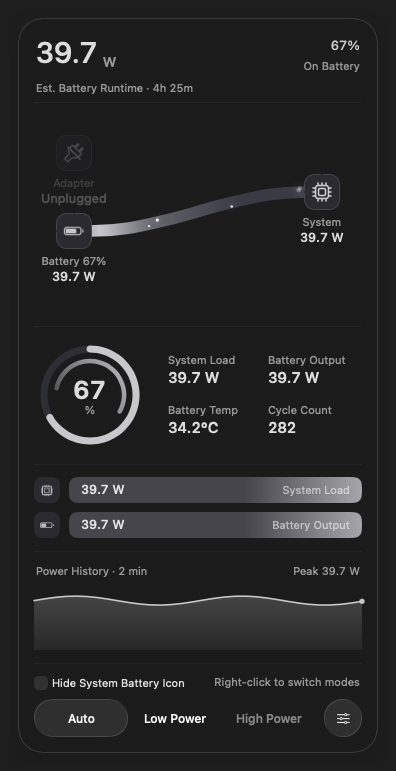
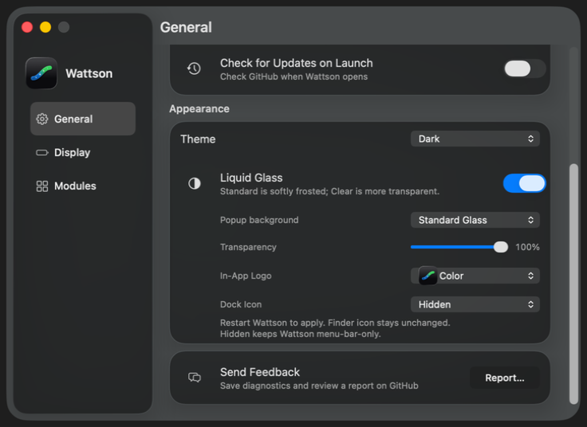

# Battery runtime, feedback and glass edge review

Development review, 13 October 2026. The source version remains 4.3.1; these
captures describe development changes, not a published installer. Images are
real WindowServer captures from the disposable arm64 macOS 26.6.1 test VM,
using the production views with fixed power fixtures and simulated controls.
They verify presentation, not battery-runtime prediction accuracy.
Accessibility gallery rows use the existing DEBUG environment overrides for
Wattson's solid-background/selector fallback. They do not change macOS settings
or demonstrate the system compositor's own increased-contrast treatment.
The Settings GUI suite separately checks contrast borders with injected policy.

The runtime layout in this initial gallery is superseded by the 14 October
[independent runtime section](runtime-section/README.md). The estimate source
and feedback behavior below remain unchanged.

## Runtime method

The implementation follows established system-data approaches:

- [Stats, pinned reader](https://github.com/exelban/stats/blob/88d5359ad3466efaa16985646a0bb15c6599109f/Modules/Battery/readers.swift#L60-L94)
  reads the internal battery's public IOPS `Time to Empty` field. Its
  current-times-voltage calculation is a separate power reading.
- [Hammerspoon](https://github.com/Hammerspoon/hammerspoon/blob/master/extensions/battery/libbattery.m)
  uses the system-wide remaining-time API. Wattson selects the internal battery
  rather than accepting a UPS estimate.
- [BatteryBoi, pinned implementation](https://github.com/thebarbican19/BatteryBoi/blob/a84bec2d2681defdeab2fd25cae35fec1a815cc6/BatteryBoi/Objects/BBBatteryManager.swift#L345-L439)
  parses system time and has a historical percentage-based fallback. That
  fallback has not been adopted without accuracy evidence.

[Apple's field contract](https://developer.apple.com/documentation/iokit/kiopstimetoemptykey)
defines minutes, with -1 while calculating, valid only on battery and while
not charging. Wattson shows an estimate only from a present internal battery;
external power and stale readings suppress numeric runtime. A fresh unknown
value clears the previous estimate. Explicit zero is rendered as less than a
minute; [Apple's source](https://github.com/apple-oss-distributions/PowerManagement/blob/d415e45501842834a280930c3eed9186544a67f0/pmconfigd/BatteryTimeRemaining.m#L1783-L1815)
marks negative values, rather than zero, as unknown. No custom runtime formula,
smoothing fallback or additional sampling timer has been added.

The existing sampler reads the latest system estimate about once per second
with the popup visible and once every two seconds while hidden, with immediate
refreshes on power-source notifications and wake. Reading that field more
often does not make macOS recalculate it more often. The number is an estimate
of remaining time, not a guarantee under a future workload. The fixed
265-minute (`4h 25m`) VM fixture verifies formatting and visibility only.

## Power-state gallery

The full popup includes the new runtime line, flow, ring, lanes, history and
footer. Values are fixture inputs. The smaller 1024×768 test session also
verified the production scroll viewport; the images below use a larger guest
display so the entire popup fits.

| State | Standard Light | Standard Dark | Reduce Transparency, Dark |
| --- | --- | --- | --- |
| Charging | [Image](standard-charging-light.png) | [Image](standard-charging-dark.png) | [Image](reduced-standard-charging-dark.png) |
| Full | [Image](standard-full-light.png) | [Image](standard-full-dark.png) | [Image](reduced-standard-full-dark.png) |
| On battery | [Image](standard-battery-light.png) | [Image](standard-battery-dark.png) | [Image](reduced-standard-battery-dark.png) |
| Mixed supply | [Image](standard-mixed-light.png) | [Image](standard-mixed-dark.png) | [Image](reduced-standard-mixed-dark.png) |
| Low battery | [Image](standard-low-battery-light.png) | [Image](standard-low-battery-dark.png) | [Image](reduced-standard-low-battery-dark.png) |
| Low Power | [Image](standard-low-power-light.png) | [Image](standard-low-power-dark.png) | [Image](reduced-standard-low-power-dark.png) |

## Feedback

General → Send Feedback → Report saves a reviewable text report and opens the
official GitHub Issue draft. The report includes app/build/package versions,
macOS build, CPU/model/architecture, preferences, accessibility, helper status,
current-or-stale displayed readings and allowlisted raw battery inputs. It
excludes serial numbers, account/host names, personal paths and logs. The user
reviews and attaches the report before submitting the issue.

The app's sandbox retains its existing restrictions and adds only
[user-selected file access](https://developer.apple.com/documentation/bundleresources/entitlements/com.apple.security.files.user-selected.read-write)
for the native Save dialog. The isolated sandbox-signed probe uses the actual
production feedback action. Cancellation verified no file, no issue draft and
an enabled control. External keyboard/pointer input to the test VM then accepted
the actual Powerbox dialog: the report was saved in guest Documents outside the
app container, its expected fields were verified, and one GitHub draft URL was
captured by the test callback. No browser was opened and no issue was submitted
by the test.

## Edge investigation

The popup's Reduce Transparency foreground was an unrounded opaque sibling
above native glass. It now stays transparent in an actual glass panel, and the
rounded backing provides the accessibility fill. Reparenting refreshes the
background without clipping the interactive footer.

The reported Settings image exposed native group shadows clipped at the General
viewport. Actual Light/Dark comparisons ruled out the default scroll background
color and the glass batching container: clearing the color and removing batching
independently left the same boundary. Removing only group glass in a frozen QA
variant removed it, confirming native shadow clipping. Pixel measurements against
the unscrolled Modules page showed the shadow continuing beyond the initial
10-point gutter. The viewport now extends through the existing 20-point detail
margins, with compensating document insets. The scroll background is explicitly
clear. Feedback keyboard focus reveals the same optical bounds.

Real Light/Dark comparisons after two layout/display cycles retained identical
group, native glass, content, box, row, Report button and popup frames. The clip
expanded from `[194, 10, 499, 452]` to `[184, 0, 519, 472]`; the legacy scroller
moved to the outer margin and stayed fully visible. Geometry recorded before
display settlement was misleading while AppKit changed overlay/legacy layout,
so the gallery records settled frames. Card/row sizing and positions are retained.

The complete General, Display and Modules source audit also checked Light/Dark,
Classic, Reduce Transparency and Increase Contrast. Native rounded strokes,
selection outlines and accessibility contrast borders remain deliberate.
The old marked General captures are preserved for comparison:
[Light](settings-before-light.png), [Dark](settings-before-dark.png).

| Page / state | Light | Dark |
| --- | --- | --- |
| General, final source | [Image](settings-general-light.png) | [Image](settings-general-dark.png) |
| General, Reduce Transparency fallback override | [Image](reduced-settings-general-light.png) | [Image](reduced-settings-general-dark.png) |
| General, Increase Contrast fallback override | [Image](contrast-settings-general-light.png) | [Image](contrast-settings-general-dark.png) |
| Display, unchanged page from the full audit | [Image](settings-display-light.png) | [Image](settings-display-dark.png) |
| Modules, unchanged page from the full audit | [Image](settings-modules-light.png) | [Image](settings-modules-dark.png) |

[Settled Light/Dark geometry comparison](settings-geometry-comparison.json)
records the unchanged controls and expanded clip.

## Verification

- Swift: 378 tests passed with warnings treated as errors.
- Python: 503 tests completed, with four existing opt-in GUI skips.
- Universal production executable: arm64 and x86_64 compiled with warnings
  treated as errors; both slices retain macOS 12.0 deployment.
- Final Settings GUI: eight tests passed in 137.069 seconds, including 500
  retained-window cycles and 500 construction/release cycles. File descriptors
  remained at five; the stable memory plateau spread was 573,440 bytes.
- Final General captures: six real windows across Light/Dark and normal,
  Reduce Transparency and Increase Contrast fallback overrides. All nested
  Feedback frames and the scroller were verified after display settlement.
- Earlier unchanged popup paths: Standard/Clear, six power states, repeated
  open/close, real interactions, and normal/reduced-transparency captures.
- Actual sandbox feedback Save and Cancel paths passed. Save wrote outside
  the app container and produced exactly one mocked GitHub draft URL.

The final 180-input GUI manifest matched before and after verification:
`003cce3a927b0c103ed5bfb6b548987195b833eff6206baee85bd211668cb1f7`.
Production Settings source SHA-256:
`2fa8c65ddf0c33b03a002a31da7c33af97362fdd9ac26f471894776e8c93f66a`.
Full logs, frozen sources and failed isolation evidence remain under
`.build/feedback-runtime-review.noindex/`. This is a development verification;
it does not replace the hosted installer and publication gates.

The subsequent [optional runtime module review](runtime-module/README.md)
records moving the runtime line into the existing selectable module menu and
Settings → Modules, while retaining the estimate source and default layout.
