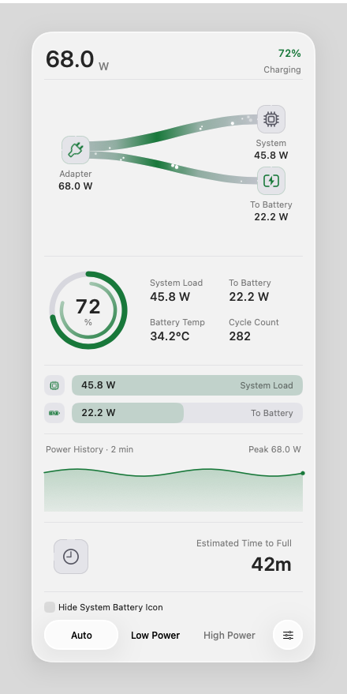
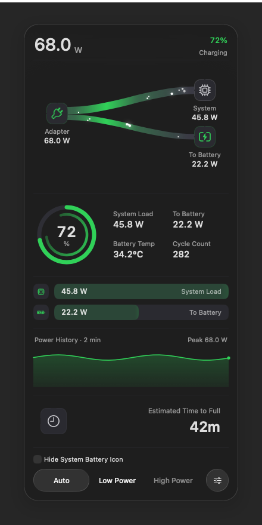
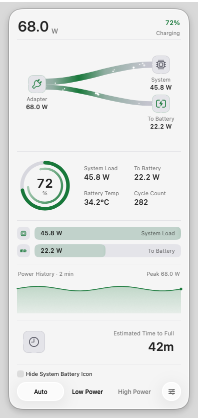
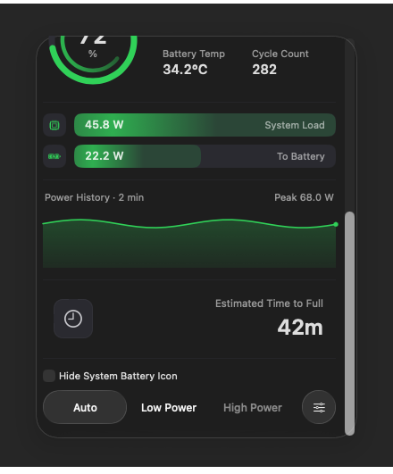

# Issue 19 — Standard Glass optical margin

Development investigation, 15 October 2026; no installer or release is implied.
These are real WindowServer images from the disposable arm64 macOS 26.6.1
(25G76) GUI VM, captured at 1 pixel per point on its 1600 × 1200 display.
The production `PopoverController`, `GlassPopoverPanel`, and content renderer
display a fixed charging fixture, not telemetry from a user's Mac. The clock
value, history, and disabled helper controls are fixtures.

The controlled experiment retains the same 360 × 799-point content rectangle
and constant background in each appearance. Only the panel frame and its three
sibling frames change for 10, 20, 32, and 48-point optical margins. The probe
waits for native placement to settle and checks the actual panel and sibling
geometry before capture. Its process-local Reduce Motion override stops the
fixture's content animations without changing macOS settings. The owned-window
CG capture composites only this process's panel and backdrop; no other app's
windows are captured. It does not use a view bitmap cache.

## Result

Regular material already has `hasShadow = false`. Its native optical treatment
extends outside the material's rounded rectangle and is clipped by the old
10-point window margin, producing the straight outer box in the report.
Increasing the margin lets that treatment fade before reaching the window edge.

| Standard Glass margin | Light: boundary jump, L/R/T/B | Dark: boundary jump, L/R/T/B |
| --- | --- | --- |
| 10 pt | 5 / 5 / 2 / 7 | 2 / 2 / 1 / 3 |
| 20 pt | 1 / 1 / 0 / 4 | 1 / 1 / 0 / 1 |
| 32 pt | 0 / 0 / 0 / 0 | 0 / 0 / 0 / 0 |
| 48 pt | 0 / 0 / 0 / 0 | 0 / 0 / 0 / 0 |

Values are the absolute red-channel difference in 8-bit sRGB across the
transparent panel boundary at each edge's midpoint. They describe these
controlled captures; they are not a promise about every future macOS renderer.
32 points is the smallest tested candidate without the abrupt transition in
both appearances. Clear's existing 10-point margin and window shadow have a
continuous edge in the same comparison and are retained.

| Before: Standard Light, 10 pt | After: Standard Light, 32 pt |
| --- | --- |
|  |  |

## Production placement and short-screen verification

The production change reserves the selected margin before reducing a short
screen's scrolling viewport. Classic keeps its existing 24-point chrome
allowance; Clear keeps its 10-point optical margin. The transparent panel's top
sits four points below the lower of its anchor's bottom and the usable display
top, so it cannot cover the status item.
The visible material starts 32 points inside that transparent panel. Placement
also clamps to the display's usable top edge; in the production captures, the
panel top is four points below that edge and eight points below the native
button's bottom. These are explicit geometry choices, not Apple-specified
dimensions. The controlled experiment above centers the panel to isolate its
optical edge and must not be used as production placement evidence.

A separate fixture opens the real production controller from its own actual
`NSStatusItem`, without adjusting panel or sibling frames. Twelve owned-window
WindowServer images cover Standard/Clear × Light/Dark at 1600 × 1200 and
800 × 600 points. The small-screen checks capture both the top and scrolled
bottom. All retain a 360-point content width and aligned sibling frames.
Standard's small-screen viewport is 451 points high; Clear's is 495. The full
799-point document scrolls to expose the entire runtime section and footer.
No content pixels cross the material's top edge into the optical margin.
See [all twelve geometry records](production-geometry.json).

These production-placement captures use source commit `650289d9694f`, the same
fixed charging readings as the optical comparison, normal motion, and simulated
helper availability for the footer. They verify placement and appearance, not
privileged mode changes or Cody's macOS 27 event delivery. They capture only
the probe's panel and backdrop; the menu-bar item itself is represented by the
recorded real anchor geometry rather than included in the image.

| Standard Light | Standard Dark |
| --- | --- |
|  |  |

| Clear Light, unchanged 10-point margin | Standard Dark, small-screen bottom |
| --- | --- |
|  |  |

Apple's [AppKit Liquid Glass session](https://developer.apple.com/videos/play/wwdc2025/310/)
explains that glass samples an area larger than its own shape. It does not
prescribe this margin. The patch preserves native material, corner radius,
background/content layering, and footer controls.

## Click ownership

Cody's v1 support report confirms the reported macOS 27.0.1 / 26A434 and a
single canonical 4.3.3 installation. He also reports consistent close-then-reopen
in Classic. That report contains environment facts, not an event trace: 4.3.3
has no popup trace emitter. It cannot identify which close callback fired.

Three paths could dismiss before a relayed status-button action: the global
mouse monitor, Classic's native close request, and a workspace activation
notification. The global monitor leaves the entire status-window frame to its
button action. Native close requests and activation notifications preserve that
same ownership only while a live, unmodified primary press is inside the anchor.
The button's explicit close clears its open intent before asking AppKit, so it
still closes. Hovering over the icon without a press does not prevent normal
application switching or native dismissal. Space/session dismissal is unchanged.

The decision deliberately does not infer a current press from
[`NSApplication.currentEvent`](https://developer.apple.com/documentation/appkit/nsapplication/currentevent),
which is the app's last dequeued event. It uses the current device state from
[`NSEvent.pressedMouseButtons`](https://developer.apple.com/documentation/appkit/nsevent/pressedmousebuttons).
The GUI regression also caches an old mouse-up or key event and checks that it
cannot override a live primary press. The native gate uses the public
[`popoverShouldClose`](https://developer.apple.com/documentation/appkit/nspopoverdelegate/popovershouldclose(_:))
delegate method. No timer or click debounce window is added.

The source-only support collector v2 accepts the additional fixed native-close
and activation-suppression event sources, while retaining strict field and PID
validation. It remains read-only and explicitly skips event recording for 4.3.3.
The existing v1 environment report remains valid; collecting it again would not
add the missing event sequence.

The production-placement probe is preserved as
[`tests/visual/capture_production_glass.swift`](../../tests/visual/capture_production_glass.swift).
Build it with the production Core/MenuBar/Popover sources in DEBUG and the same
owned-window C bridge as `capture_glass_shadow.swift`. Run it in a disposable
GUI session with the output directory as its sole argument. It opens only its
own fixture windows and uses in-memory settings. Display mode selection and
restoration belong to the surrounding VM runner, not the app or probe.

## Verification record

- Behavior commit `92e0f9f6c782e6b5f80d7051c37af5edcc1db99e` passes
  [hosted CI](https://github.com/laleoarrow/battery-monitor/actions/runs/38688372710):
  423 Swift tests, 517 Python tests (four expected skips), and website checks.
- On the isolated macOS 26.6.1 VM, replacing only the live-press predicate's
  body with `false` produces nine failures, all in the new native/workspace
  early-dismissal checks. The other checks in that run pass. Restoring the
  patched predicate passes the native-mode run's 332 assertions, including
  all 14 new click-order, cached-event and idle-pointer checks.
- Those paired GUI runs use a frozen archive with SHA-256
  `f0a3a23c06760161bc7bcc492f2e7cec701761f96df5c3c14ace875388b1e0c2`;
  production app inputs match the behavior commit above. The baseline edit is
  confined to its temporary guest copy. Each probe has its own bundle ID,
  registration, settings and cleanup, and never replaces an installed Wattson.
- Collector v2 passes 14 targeted VM tests. The earlier v1 channel was also
  tested with a real sandboxed fixture, allowlisted settings, four own-PID
  events, cross-volume ZIP output and cleanup. Cody successfully returned a
  v1 environment report. These validate collection, not real click delivery.

The [PR validation record](https://github.com/laleoarrow/battery-monitor/pull/21)
records the final configuration matrix and stress results separately. An earlier
five-configuration pass on `650289d9694f` had one first-display settings-button
click timeout in its Reduce Motion invocation. The same-source bounded rerun
passed; the original failure is retained. The harness's A2 block explicitly
resets accessibility overrides, and the same first-point timeout was previously
recorded in the [Classic investigation](../status-click/classic/README.md).
No footer production code was changed in response to that isolated failure.

The VM has Command Line Tools without XCTest, so full SwiftPM tests run on the
hosted macOS CI rather than being claimed as VM successes. The first private
baseline runner stopped at a heredoc error before compiling; the corrected
runner supplies the paired evidence above. The production capture runner's
initial display restoration also failed because virtual mode IDs changed;
the original logical resolution was restored by dimensions. These runner
failures are retained separately and do not count as successful checks.

These investigation checks do not reproduce the reporter's exact macOS 27
installation or prove which callback ran there. Issue 19 stays open pending
that environment's confirmation. The 4.3.4 release follows separate package,
installation and publication gates; these source-level checks alone do not
establish that a new installer has been published.
