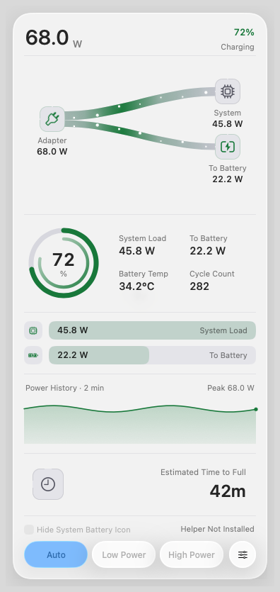
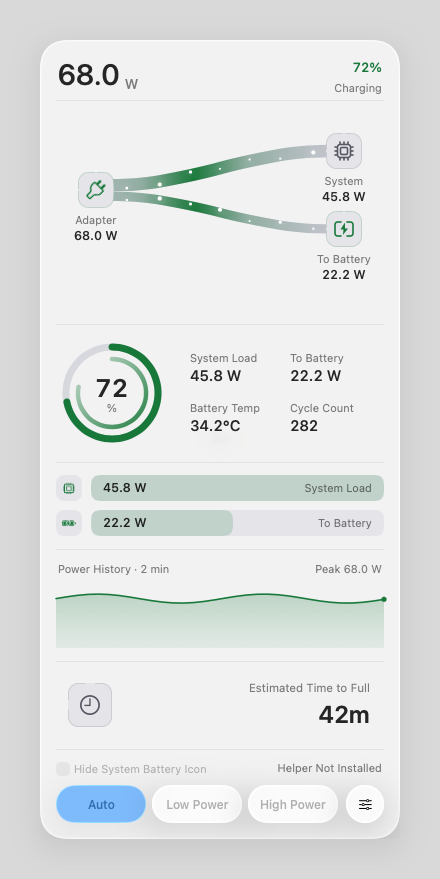
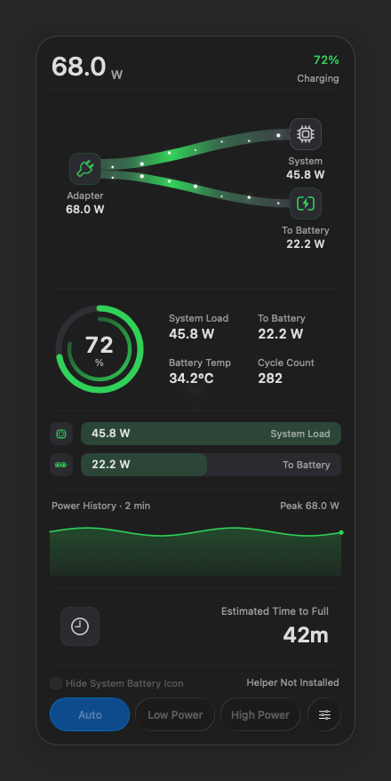

# Issue 19 — Standard Glass optical margin

Development investigation, 15 October 2026; no installer or release is implied.
These are real WindowServer images from the disposable arm64 macOS 26.6.1
(25G76) GUI VM, captured at 1 pixel per point on its 1600 × 1200 display.
The production `PopoverController`, `GlassPopoverPanel`, and content renderer
display a fixed charging fixture, not telemetry from a user's Mac. The clock
value, history, and disabled helper controls are fixtures.

The controlled experiment retains the same 360 × 799-point content rectangle
and constant background in each appearance. Only the panel frame and its three
sibling frames change for 10, 20, 32, and 48-point optical margins. The probe
waits for native placement to settle and checks the actual panel and sibling
geometry before capture. Its process-local Reduce Motion override stops the
fixture's content animations without changing macOS settings. The owned-window
CG capture composites only this process's panel and backdrop; no other app's
windows are captured. It does not use a view bitmap cache.

## Result

Regular material already has `hasShadow = false`. Its native optical treatment
extends outside the material's rounded rectangle and is clipped by the old
10-point window margin, producing the straight outer box in the report.
Increasing the margin lets that treatment fade before reaching the window edge.

| Standard Glass margin | Light: boundary jump, L/R/T/B | Dark: boundary jump, L/R/T/B |
| --- | --- | --- |
| 10 pt | 5 / 5 / 2 / 7 | 2 / 2 / 1 / 3 |
| 20 pt | 1 / 1 / 0 / 4 | 1 / 1 / 0 / 1 |
| 32 pt | 0 / 0 / 0 / 0 | 0 / 0 / 0 / 0 |
| 48 pt | 0 / 0 / 0 / 0 | 0 / 0 / 0 / 0 |

Values are the absolute red-channel difference in 8-bit sRGB across the
transparent panel boundary at each edge's midpoint. They describe these
controlled captures; they are not a promise about every future macOS renderer.
32 points is the smallest tested candidate without the abrupt transition in
both appearances. Clear's existing 10-point margin and window shadow have a
continuous edge in the same comparison and are retained.

| Before: Standard Light, 10 pt | After: Standard Light, 32 pt |
| --- | --- |
|  |  |

## Placement consequence and remaining verification

The production change reserves the selected margin before reducing a short
screen's scrolling viewport. Classic keeps its existing 24-point chrome
allowance; Clear keeps its 10-point optical margin. The transparent panel's top
stays four points below its anchor, so it cannot cover the status item.
Consequently the Standard material's visible top is now 36 points below the
anchor instead of 14. This is an explicit geometry choice, not an Apple-specified
dimension. The experiment above centers the panel to isolate its optical edge;
it does not establish production menu-bar placement, short-screen scrolling,
mouse delivery, or the full power-state/accessibility matrix. Those require
the separate production-host GUI checks before claiming the issue resolved.

Apple's [AppKit Liquid Glass session](https://developer.apple.com/videos/play/wwdc2025/310/)
explains that glass samples an area larger than its own shape. It does not
prescribe this margin. The patch preserves native material, corner radius,
background/content layering, and footer controls.
