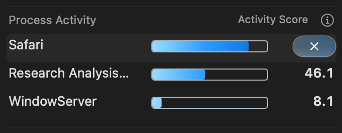
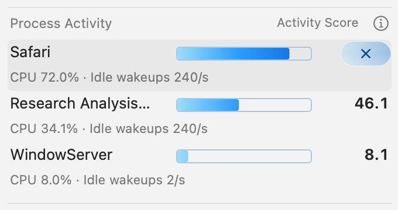

# Process action capsule and concise hover text

The latest [uniform-width follow-up](uniform-38/README.md) makes every capsule
38 × 16 points, retaining the text-aligned right edge. The preceding
[text-alignment follow-up](score-aligned-16/README.md) used each score's width;
the user subsequently requested one width matching its longest ordinary score.
The [preceding intermediate](score-width-16/README.md) retains the rejected
alignment to the text field's outer edge.
The earlier [bar-height follow-up](thin-12/README.md) records the 44 × 12-point
version; the [preceding follow-up](thin-18/README.md) records 44 × 18 points.
The initial implementation and accepted images below record the preceding
44 × 22-point version.

Selecting a process replaces its score with a 44 × 22-point × capsule at the
right edge. The process name remains at x=0, width=132, and the bar and all other
text retain their frames. Deselecting restores the score. The native force-quit
confirmation and identity checks retain their behavior.

On macOS 26, the button uses AppKit's `.glass` bezel and `.capsule` border shape.
A thin blue gradient and reflected rim sit above the native material, below its
symbol. Older systems use the same compact capsule. One existing
`FooterHoverFeedbackView` supplies pointer-following surface and rim light for
the selected button. It adds no timer, per-row observer or event interception.
Reduced Motion, Reduced Transparency and high contrast use static feedback;
deselecting, hiding or dismissing clears it.

Row hover text is limited to the full name/PID and one rounded readout:

```text
backupd · PID 86572
Score 92.4 · CPU 92.4% · Wakeups 0/s
```

Raw floating-point precision and the repeated paragraph are removed from hover
text. The full explanation remains in the information popover; its tooltip is
only “About Activity Score.” Accessibility values use the same concise numeric
precision with descriptive component names.

## Reopening and Top 3

The application default already was Top 3. The user's existing installation had
saved 10; the canonical Settings UI was used to change only that count to 3.
Its initially disabled module state was restored after enabling the quantity
control temporarily. No new app/helper was installed or released.

Display count does not reduce the helper's one-second two-snapshot interval.
Repeated openings now reuse a successful in-memory sample younger than ten
seconds, retaining its original refresh deadline. Closed or disabled modules
still do not poll. Expired, invalidated or failed samples are not reused; late
results from a previous generation cannot populate the cache. Wake and a
force-quit intent invalidate it, and force quit stops monitoring before popup
dismissal so its closing animation cannot trigger a doomed read.

Variable Process Activity colors were requested as a separate TODO and remain
pending. This change does not add a color setting or alter the score formula.

## Verification

The final headless suite passes [628 Swift tests](headless/swift-tests.log) and
[601 Python checks](headless/python-tests.log), with four Python checks skipped.
The [42 targeted checks](headless/focused-tests.log) cover
the right-edge layout, hidden/restored score, concise hover text, native button
dispatch, shared reflection lifecycle and twelve monitor tests including the
ten-second boundary, old completions, failure, wake and force-quit invalidation.
The [native accepted run](host-run.log) passes 10,376 assertions and records
[100 production-renderer captures](accepted/results/gui/evidence.json), covering
six power states, both themes, both popup hosts and both display modes. It
includes selected/unselected score replacement, left/right pointer reflection,
concise tooltips and twelve real controller confirmation dialogs with cache
invalidation intent verified before dismissal. The helper worker's owned-child
check also passes. The
[guest resource audit](accepted/results/resource-audit.json) and
[VM inventory/deletion check](accepted/vm-cleanup-summary.json) pass; test apps,
registrations, preferences, containers, child processes and source scratch are
removed. System accessibility preferences remain unchanged.

The source in [the production manifest](accepted/frozen-production-inputs.sha256)
matches this implementation. Images use synthetic, arithmetically consistent
process fixtures, not the user's workloads.
Readable logs omit trailing whitespace; adjacent `.gz` files preserve the raw
bytes wherever this normalization was required.




