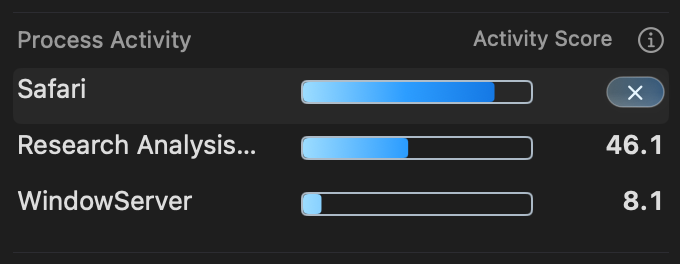

# Score-aligned process action capsule

The capsule now aligns with the score's text content, accounting for AppKit's
text-cell padding. The preceding 16-point intermediate aligned to the outer
field edge and was rejected by the user as visually unbalanced.

The native cell measurement adds four points to the score's typographic width,
providing two-point horizontal text insets. The action therefore ends at x=326
instead of x=328. Its width stays equal to the current score's typographic
width, capped by the available text area. The 16-point height (y=4), 9-point ×,
glass gradient and pointer reflection remain. Process names, score fields,
bars, row heights and termination behavior retain their geometry/behavior.
No app/helper is installed or released.

Thirty-one focused view/button tests pass on committed base `24b894b` plus this
change's two production and two test files. Short, tiny and large scores are
updated while selected in both row modes, checking width, horizontal center,
right alignment and fixed text/bar positions. The shared lifecycle helper
removes the isolated source/build workspace. The log, base and overrides are
retained here.

The real AppKit production popup hosts are verified in an owned disposable ARM
GUI VM. Input manifests, captures and cleanup records are retained in
`accepted/`; images use synthetic process fixtures.

All 10,424 native assertions pass. The selected 84.0 fixture's actual capsule
is 29.5633 × 16 points at x=296.4367, with right edge x=326. Light/dark selected
renders confirm the text-content alignment and intact symbol. The 100 retained
captures include pre-existing early unselected crops taken before the scrolled
content was displayed; those images show other sections and are excluded as
visual alignment evidence. Frame-preservation assertions remain valid.

