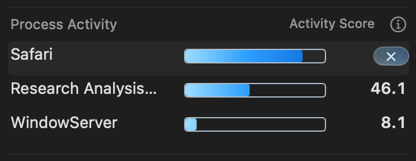

# Score-width process action capsule

The selected row's action capsule is limited to the current score text's
typographic width, capped at the unchanged 56-point score field. It stays
right-aligned at x=328. Its height increases from 12 to 16 points (y=4), sharing
the 12-point bar's vertical center. The mini native control uses a 9-point ×.
Names, bars, score fields and row heights retain their frames. Selection,
confirmation, identity checks and the existing glass/reflection behavior are
unchanged. No app/helper is installed or released.

Thirty-one focused view/button tests pass on committed base `24b894b` plus this
change's two production and two test files. They include short, tiny, large and
changing scores in both row modes, with fixed text/bar positions and a capsule
no wider than its score. The shared lifecycle helper removes the isolated
source/build workspace; provenance and overrides remain beside the test log.

Native verification uses the production popup hosts and AppKit renderer in an
owned disposable ARM GUI VM. Its input manifests, captures and cleanup records
are retained in `accepted/`. Images use synthetic process fixtures.

All 10,424 native assertions pass with 100 captures across six power states,
both themes, both hosts and both row modes. The 84.0 fixture's actual capsule is
29.5633 × 16 points, with right edge x=328; the 8.1 fixture is narrower. The
visible bezel is fuller than the preceding 12-point version and the 9-point ×
is centered and unclipped. Guest resource checks and owned-VM deletion pass.

