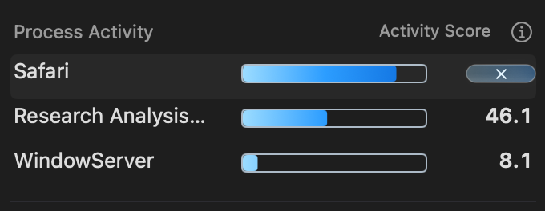

# Bar-height process action capsule

The action capsule is now 44 × 12 points at x=284, y=6, matching the adjacent
bar's height and vertical center. The × symbol is 8 points with the mini native
control size. Names, row heights and bar geometry retain their positions.

Thirty focused view/button tests pass on committed base `542478a` plus this
change's two production and two test files. This isolated source copy avoids
unrelated concurrent work; the shared lifecycle helper removes its entire
source/build workspace after testing. Test provenance and overrides are retained
beside the log.

The owned-VM evidence in `accepted/` checks the real native glass bezel,
pointer-light feedback and centered symbol. The full moving checkout is not
claimed verified; concurrent changes remain untouched. No app/helper is installed.
The [owned-source record](owned-source-verification.json) defines this boundary.
Guest resource cleanup and owned-VM deletion both pass. Readable logs omit
trailing whitespace; adjacent `.gz` files retain the original bytes when needed.

The native run passes 10,376 assertions and retains 100 captures. Dark compact
and light detailed renders confirm the capsule is visibly level with the
12-point bar and the 8-point × remains centered and unclipped.

