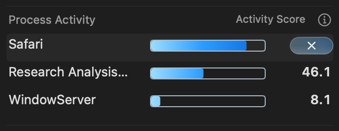

# Thinner process action capsule

The user requested a narrower button height. The action capsule changes from
44 × 22 points at y=1 to 44 × 18 points at y=3, retaining the same vertical
center and 10-point × symbol. Width, name, bar, score slot and row heights retain
their existing geometry. The same shared reflection follows the smaller bounds.

Thirty [focused view/button tests](swift-tests.log) pass. The existing owned-VM
production-renderer matrix passes 10,376 assertions and records 100 captures of
the visible native glass bezel, symbol, pointer light and real
button tracking in both themes, hosts and display modes across six power states.
Its evidence is retained in `accepted/`. No app/helper installation is performed.
Guest resource cleanup and owned-VM deletion both pass.

Other work changed unrelated battery/settings sources after the native snapshot.
The result therefore attests to the frozen inputs and the matching capsule
renderer/harness, not the entire moving checkout. Those unrelated edits are
preserved and excluded from the size-change commit; see
`owned-source-verification.json` for the exact boundary.

The native bezel is visibly 4 points shorter and the unchanged symbol is not
clipped. The screenshot uses synthetic process values.

