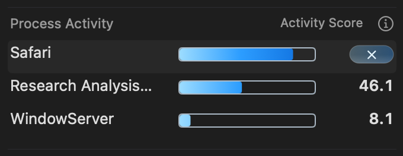
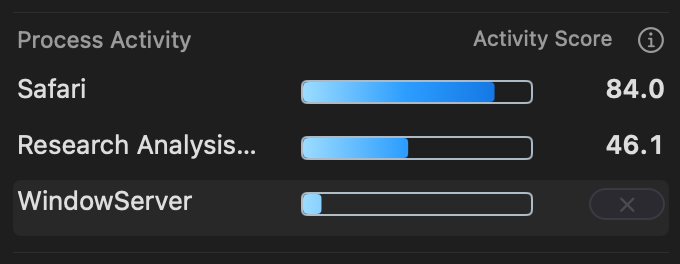

# Uniform-width process action capsule

Every selected process uses the same 38 × 16-point capsule at x=288, y=4,
ending at the text-aligned x=326. This matches the longest ordinary score
format (for example 131.2) from the preceding preview. Score changes, digit
counts, display density and process eligibility no longer alter its width.
The 9-point ×, native glass, gradient and pointer reflection are unchanged.

Unavailable actions remain disabled and grey. Wattson requires a trusted
termination identity for a process eligible to its unprivileged console-user
worker. The WindowServer example in the user's screenshot does not supply an
eligible action. No termination privilege, signal path or eligibility check
is changed by this layout correction.

Verification uses committed source recorded in `test-base.txt`, focused Swift
view/button tests, and the production AppKit popup hosts in an owned disposable
ARM GUI VM. The native harness compares enabled/disabled frames directly and
retains dedicated disabled-state captures. Early unselected crops from the
existing harness are excluded as visual evidence because they precede the
scrolled display's refresh. Fixtures contain synthetic process readings.

All 31 focused tests and 10,424 native assertions pass. The 108 retained
captures include eight dedicated disabled-state images. All 56 recorded action
frames (enabled and disabled) equal {{288, 4}, {38, 16}}. The visible bezel and
symbol were checked in light/dark and compact/detailed renders.

