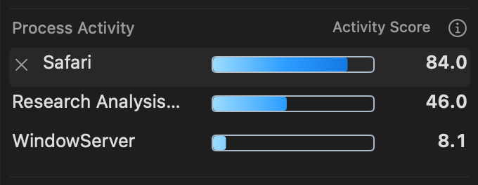

# Process Activity force quit

This development change implements the requested Stats-like row interaction in
Wattson's existing AppKit Process Activity module. It does not install or release
a new app. `/Applications/Wattson.app` remains the released 4.3.19 installation.

Clicking a row reveals an 18-point borderless × using Wattson's secondary text
color. Only its name moves to make room; the fixed-scale blue gradient, value
and detail geometry remain unchanged. Compact and detailed modes share the
interaction. Selection follows the full process identity when rows reorder and
clears on disappearance, identity change, hiding or closing. The selected row
and action expose accessibility metadata and keyboard navigation.

The action closes the popup before presenting a native confirmation. Escape
cancels; Return leaves the alert open. The force-quit action requires an explicit
choice. The presenter retains the
selected identity, rejects duplicates and ignores callbacks from old requests.
It performs IPC off the main thread and presents allowlisted failure feedback.

The read response optionally includes the PID, monotonic start time and all
32 bytes of the kernel audit token. Legacy readings without identity remain
usable, with the selected action disabled. The fixed helper worker permanently
drops root credentials before checking console-user ownership and exact identity.
It uses the atomic audit-token signal API for SIGKILL, without PID-only fallback
or any client-selected signal, command or executable. Missing safe APIs disable
this optional action. Monitoring, ranking, gradients and sampling cadence retain
their existing behavior.

## Headless verification

- [615 Swift tests](headless/swift-tests.log): zero failures, including an
  actual identity-bound SIGKILL of an owned test child followed by reaping.
- [25 row tests](headless/row-tests.log): zero failures after making the test
  audit tokens structurally valid; coverage includes selection, reorder,
  replacement identity, compact mode, lifecycle and accessibility geometry.
- [30 presenter/row checks](headless/confirmation-retest.log) pass on the final
  confirmation code. Native investigation corrected our initial test assumption
  that Cancel should be the Return default. Making it the Return equivalent
  removed native Escape cancellation. The final alert deliberately has no
  default action and retains Escape for Cancel, consistent with
  [Apple's alert guidance](https://developer.apple.com/design/human-interface-guidelines/alerts).
- [Initial Python regression](headless/python-initial.log): 601 tests, four
  skipped, one failure. The isolated Intel/macOS 12 compiler harness omitted
  the new support source from its explicit source list. After correcting that
  list, [the exact failing test passed](headless/helper-cross-compile-retest.log).
- Existing shell syntax and diff-whitespace checks pass. Independent read-only
  backend and UI reviews found no confirmed defects.

The Python initial log and native guest stderr have trailing whitespace removed
in their readable copies; adjacent `.gz` files preserve the exact raw bytes.

## Native acceptance

The [accepted run](native/accepted-final-host.log) uses an ad-hoc signed,
sandboxed test app in an owned ARM macOS GUI VM. The frozen production source
is recorded in [the input manifest](native/accepted-final/frozen-production-inputs.sha256).

- [760 assertions and 72 WindowServer captures](native/accepted-final/results/gui/evidence.json)
  pass with zero failures: six power states × Light/Dark × Classic/Glass ×
  compact/detailed. Native mouse events select rows and track the × button.
- Twelve production-controller confirmation captures prove that the popup
  actually closes and the modal appears. Explicit observed/delivered flags
  prevent an absent alert from passing. Return is verified to keep the alert
  open before the test cancels it. The live presenter also passes independent
  Cancel, Escape, Return and explicit Force Quit checks with a spy executor.
- [The production root worker](native/accepted-final/results/root-worker.json)
  rejects a stale identity and root UID without disturbing the owned child,
  permanently drops credentials, sends SIGKILL to that child and reaps it.
  This exercises the worker entry; no LaunchDaemon or socket installation is
  performed. Socket dispatch remains covered by source review and headless tests.
- [Guest resource cleanup](native/accepted-final/results/resource-audit.json)
  and [VM deletion/inventory](native/accepted-final/vm-cleanup-summary.json) pass.
  Test apps, registrations, preferences, containers, processes and scratch are
  removed. Existing VM states and system accessibility preferences are preserved.

The images use synthetic process and battery fixtures, not the user's live
workloads. In the accepted matrix's 8.1-point fixture, the CPU/wakeup inputs were
not arithmetically consistent; the permanent harness corrects that fixture after
the run. This does not change production code, row geometry or modal assertions.
The compact previews omit those secondary inputs:



To repeat in a new, caller-owned output directory under the project:

```bash
bash design/process-force-quit/native/run-owned.sh "$PWD/.build/force-quit-native-review.noindex"
```

The runner requires the stopped `macOS-TestLab-Base` Tart VM, creates its own
snapshot and disposable clone, and cleans both on success, failure and catchable
interruption. It retains the requested evidence directory. The earlier harness
failures and corrections are recorded in the native diagnostics; the final
success and failure-trap checks are separate. The previous performance work's
unresolved History motion acceptance remains outside this feature.
