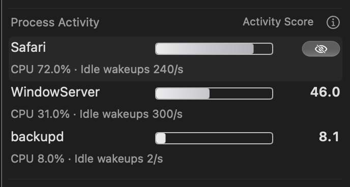
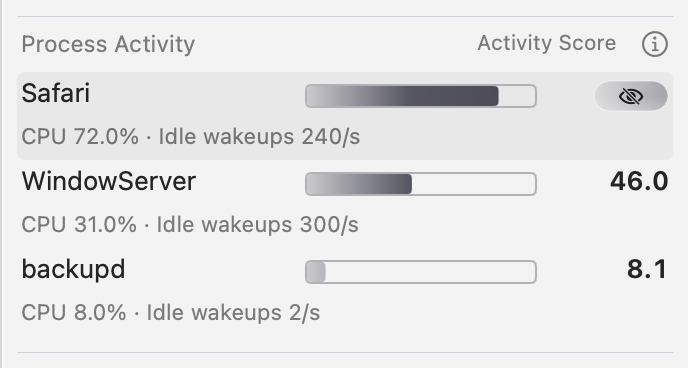
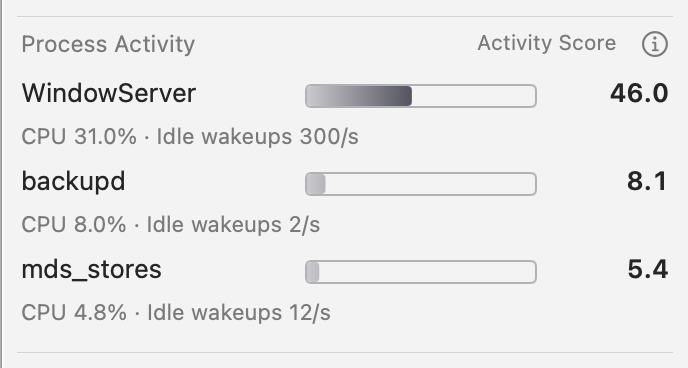
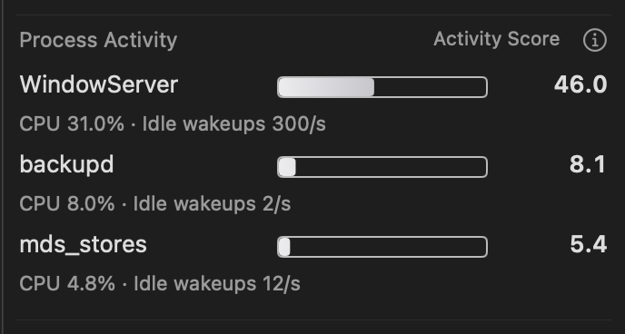
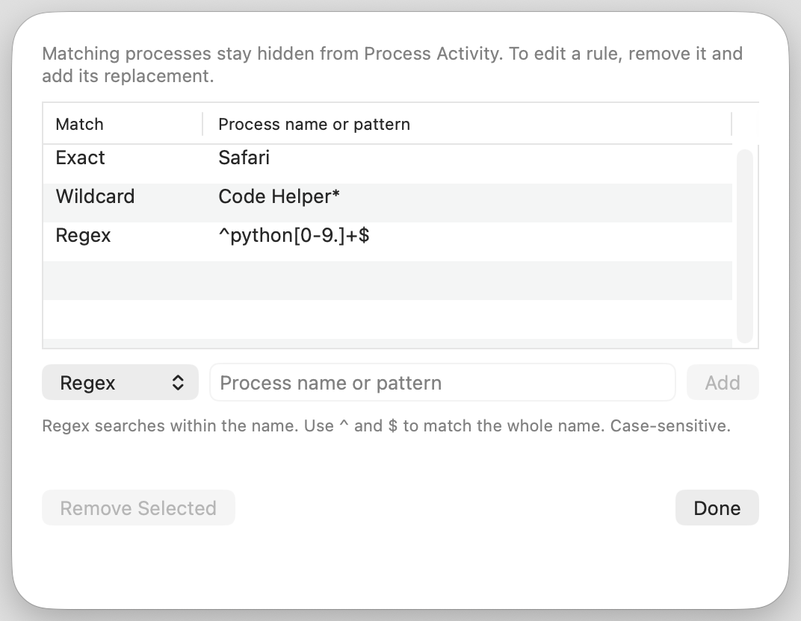
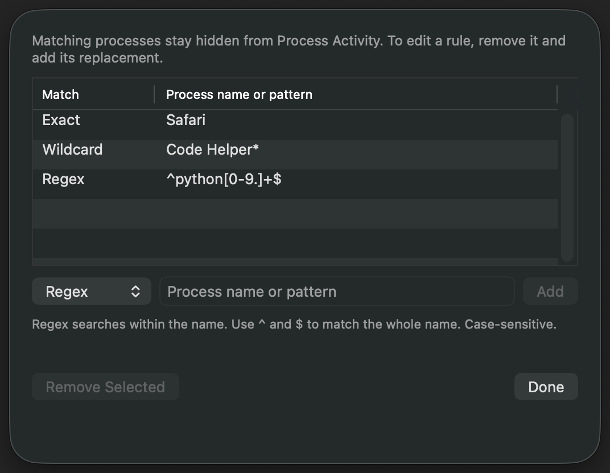

# Process whitelist · 2026-10-20

Ordinary process-row clicks show the existing Force Quit action. Command-click
shows the `eye.slash` action; activating it saves an exact process-name rule and
immediately hides matching rows. The next eligible sampled process fills the
available row. Settings > Modules > Process Activity > Whitelist opens the
native editor with Exact, Wildcard and Regex modes, validation and removal.

Exact and wildcard matches are case-sensitive and match the whole process
name. Wildcards support `*` and `?`; regular expressions search within the name,
with `^` and `$` available for whole-name matching. Regex work shares a 10 ms
cooperative deadline per process name. Filtering uses the sampler's existing ten
candidates before applying the selected display count, so fewer rows can remain
when many candidates are hidden. Whitelisting changes display preferences and
does not terminate a process.

The final-source production-renderer matrix passed **158 captures and 6,926
assertions**, covering charging, full, on-battery, mixed supply, low battery and
Low Power in Classic/Regular Glass and Light/Dark. Native window mouse events
verified the ordinary and Command-click actions; the actual whitelist button
saved an exact rule, removed Safari and filled its row. The actual Settings sheet
added all three match modes and rejected invalid regex.

The final [native interaction gate](native-interaction.json) also passed.
[Guest cleanup](guest-cleanup-audit.json) observed 37 seconds without delayed
preference writes and confirmed removal of scratch, processes, registrations
and test data. [Host cleanup](vm-cleanup-summary.json) removed the owned clone
and preserved both existing VM states. The complete entrypoint exited 0.

[Source verification](source-verification.json) matches all 59 compiled renderer
inputs and all 64 transported Swift files to the final working tree, including
the Settings keyboard-focus fix and the shared per-name regex deadline.
[Capture metadata](capture-evidence.json) retains every image digest and assertion
total. The [environment](system.txt) was an owned ARM GUI VM running macOS 26.6.1,
Swift 6.3.3 and SDK 26.5.

The images below are unedited native WindowServer regions from real production
views with fixture readings. Process sampling and physical battery telemetry are
outside this visual check. Full images and logs remain in the ignored local
`dist/process-whitelist/final-source-validation-20261020` directory. The canonical
installation and production preferences were not changed.

| Production action | Light | Dark |
| --- | --- | --- |
| Classic |  |  |
| Regular Glass |  |  |

| After adding Safari | Light Classic | Dark Glass |
| --- | --- | --- |
| Name hidden; next rank fills the row |  |  |
| Settings rule editor |  |  |

Reproduce the complete visual and native-interaction gate with
`bash scripts/verify_process_whitelist_vm.sh NEW_OUTPUT_DIRECTORY`. The entrypoint
owns a disposable clone, guest-local builds, registrations, preferences,
containers and child processes through the shared lifecycle helpers.
