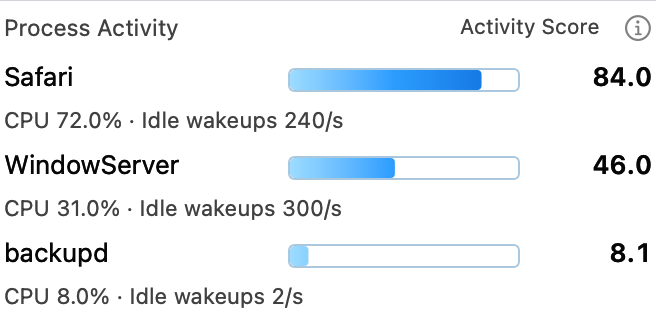
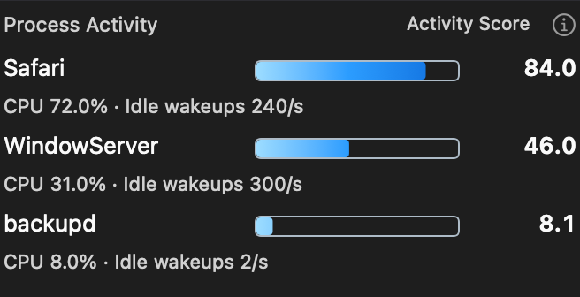
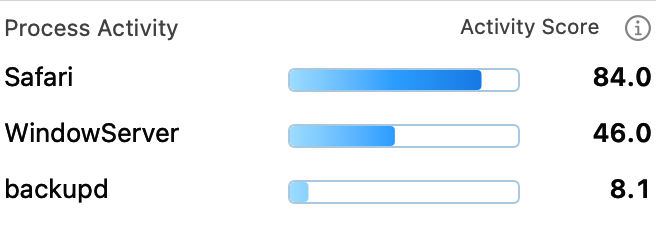
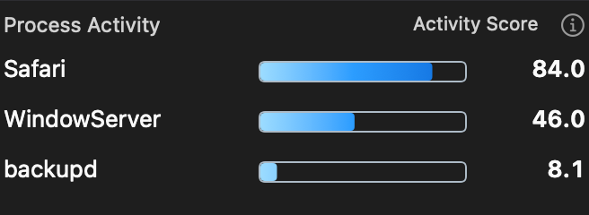
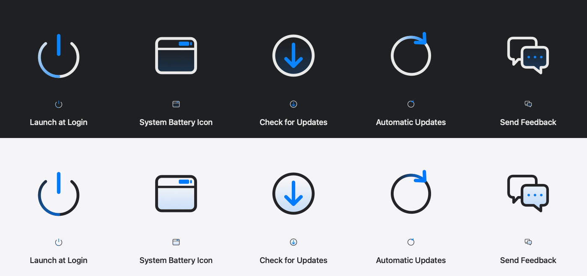
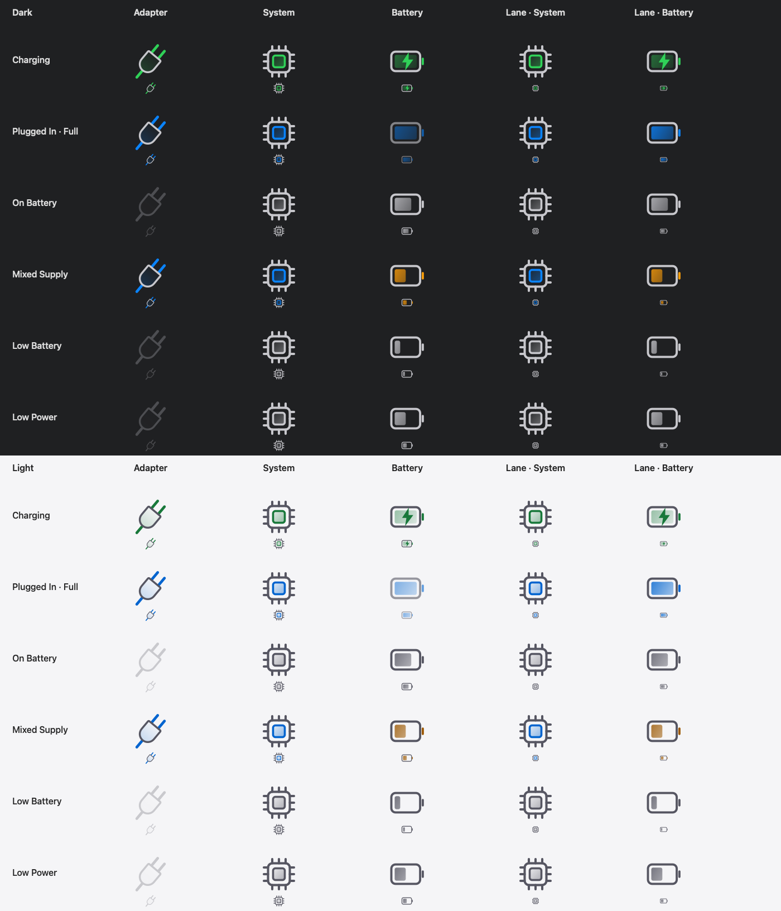

# Wattson 4.3.19 · approved design gallery

This versioned gallery presents approved vector artwork and native **offscreen
renders**, rather than screenshots of the running app. It covers the design
changes accumulated since the previous public version, 4.3.8.

- **Process Activity:** configurable Top N (default 3); a fixed 0–100 light-blue
  to dark-blue gradient revealed only up to each score; optional compact rows.
  Compact view uses the approved small Off/On dropdown in Modules settings.
- **Modules and Settings:** persistent module ordering with Restore Default
  Order, six module icons including the new horizontal Process Activity icon,
  three sidebar icons and five General action icons.
- **Power artwork:** editable theme- and state-aware Adapter, System and Battery
  icons used by Energy Flow and Power Lanes.
- **Other interface updates:** an optional popover arrow, refined History
  transitions, and a calculating state while unplugged runtime estimates settle.

The Process Activity samples below are illustrative fixed fixtures. Activity
Score combines CPU usage and idle wakeups; it is not measured process power or
a share of total battery consumption. A score above 100 saturates the bar and
retains its actual number. Compact mode hides the CPU/wakeup detail line.

## Process Activity · Light / Dark

| Mode | Light | Dark |
| --- | --- | --- |
| Detailed |  |  |
| Compact |  |  |

## Approved icon artwork

These production-path proofs show enlarged artwork and its actual display size.
The Settings proofs pair Dark above Light; the sidebar proof additionally
includes native emphasized-selection artwork. They do not represent installed
Settings windows or composited Liquid Glass.




## Power state matrix

The matrix shows Charging, Plugged In · Full, On Battery, Mixed Supply, Low
Battery and Low Power in Dark and Light. Connected/charging color, battery
assistance color and neutral disconnected styling retain their distinct roles.



## Editable SVG originals

- [Six Modules icons](Wattson-v4.3.19-Modules-SVG.zip)
- [Three sidebar icons](Wattson-v4.3.19-Sidebar-SVG.zip)
- [Five General icons](Wattson-v4.3.19-General-SVG.zip)
- [Five Power icons](Wattson-v4.3.19-Power-SVG.zip)

The ZIPs contain the SVG masters copied byte-for-byte from this release's
source, plus a version-labeled contents file. The Power ZIP includes the two
original Pro design sources and their normalization record in addition to its
five runtime SVG masters. These are separate design attachments; they do not
replace or alter the four checksum-gated installer assets.

[Browse the HTML gallery](index.html) · [Asset manifest](manifest.json) ·
[Design checksums](SHA256SUMS.txt) ·
[Release notes and installers](https://github.com/laleoarrow/battery-monitor/releases/tag/v4.3.19)

## Reproduce

```sh
bash design/releases/v4.3.19/render-previews.sh
python3 design/releases/v4.3.19/prepare-assets.py
```

The shell entrypoint compiles the existing production artwork renderers and
the Process Activity view with fixed fixtures. It creates no window, menu-bar
item, installed app, helper request or preferences domain. Shared lifecycle
helpers remove the temporary executable and compiler cache on exit. Exported
PNGs are preserved here, without retouching. The HTML page has no scripts,
analytics, remote font or embedded runtime capture.
