# Wattson 4.3.2

Battery Time Estimate is an independently selectable section below Power History, with the same separators and neutral colors as the other instruments. Its right-aligned title switches between **Estimated Battery Runtime** on battery power and **Estimated Time to Full** on external power. Charging shows macOS's time-to-full estimate; a full battery shows **Fully Charged**, and mixed supply shows **Not Charging**. This release also fixes repeated menu-bar clicks and glass clipping, and adds diagnostic feedback through a reviewable GitHub issue draft.

## Earlier installed trial: replacement capture pending

The image below is a composited screen-region capture of the earlier installed local 4.3.2 trial, taken on 2026-10-14 from [`ff2274a`](https://github.com/laleoarrow/battery-monitor/commit/ff2274a7becef9c4600d415396db1d46c51a444c). It preserves the native Standard Glass controls, but its **External Power** runtime status predates the dynamic battery-time behavior shown in the new fixtures below. This older trial image is pending replacement before publication and is not evidence of the current charging/full labels.

<a href="installed-standard-dark-screen.png">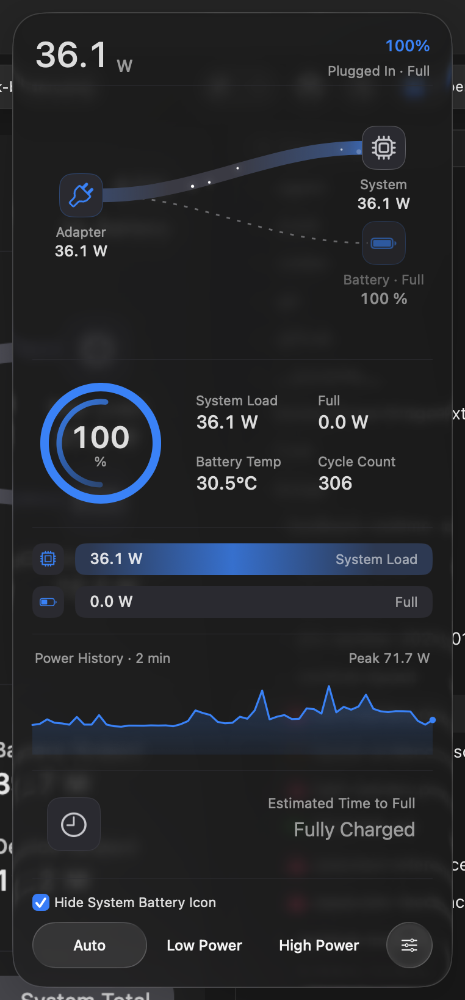</a>

## Power-state layout previews: Classic

The following twelve images were captured on 2026-10-15 with the production AppKit renderer in hidden windows, using **Classic**, **Reduce Transparency**, and **Reduce Motion**. They are deterministic layout fixtures, not composited Liquid Glass captures or live readings. The charging estimate `42m`, remaining-runtime estimates `4h 25m`, `18m`, and `5h 10m`, power readings, battery details, and history are fixed samples.

The footer uses the capture process's cached/default power mode. The Low Power fixture changes the displayed snapshot only and does not simulate a hardware power-mode switch. Click any image to view it at full resolution.

<table>
<tr><th>Light</th><th>Dark</th></tr>
<tr><td colspan="2"><strong>On battery</strong></td></tr>
<tr><td><a href="runtime-section-light-battery.png">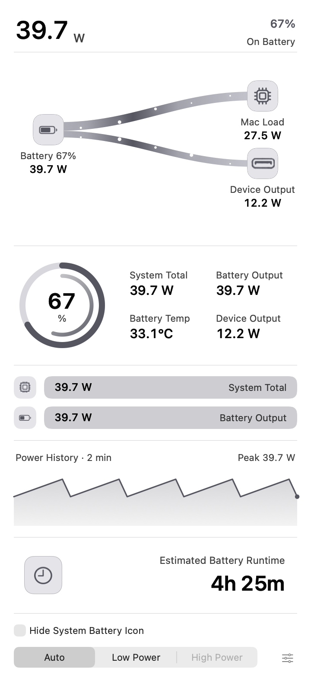</a></td><td><a href="runtime-section-dark-battery.png">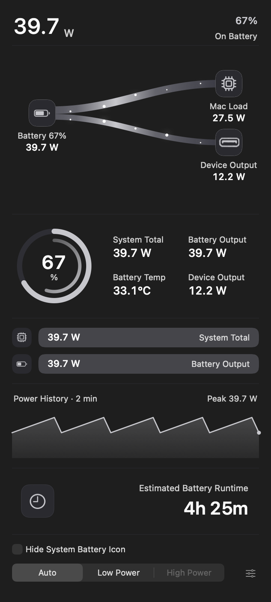</a></td></tr>
<tr><td colspan="2"><strong>Charging</strong></td></tr>
<tr><td><a href="runtime-section-light-charging.png">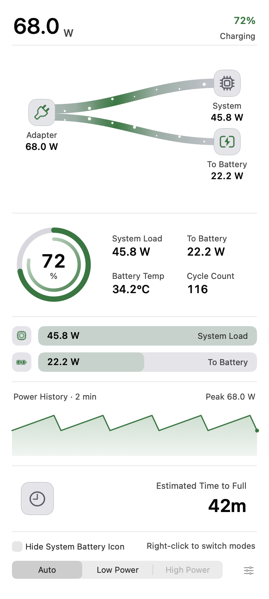</a></td><td><a href="runtime-section-dark-charging.png">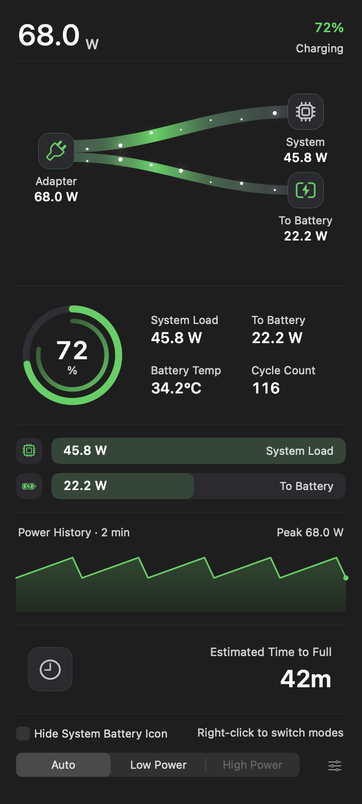</a></td></tr>
<tr><td colspan="2"><strong>Full</strong></td></tr>
<tr><td><a href="runtime-section-light-full.png">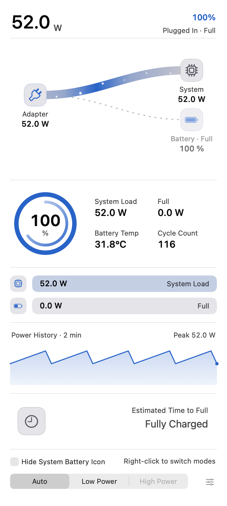</a></td><td><a href="runtime-section-dark-full.png">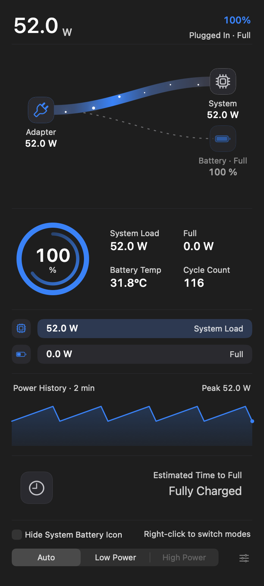</a></td></tr>
<tr><td colspan="2"><strong>Mixed supply</strong></td></tr>
<tr><td><a href="runtime-section-light-mixed.png">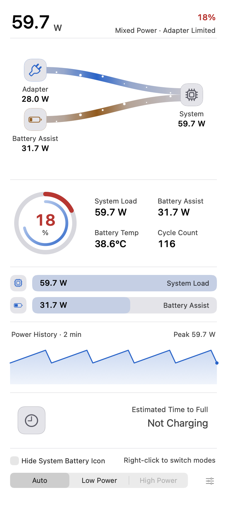</a></td><td><a href="runtime-section-dark-mixed.png">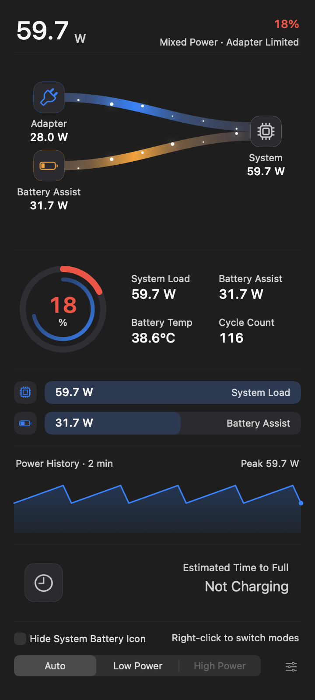</a></td></tr>
<tr><td colspan="2"><strong>Low battery</strong></td></tr>
<tr><td><a href="runtime-section-light-low-battery.png">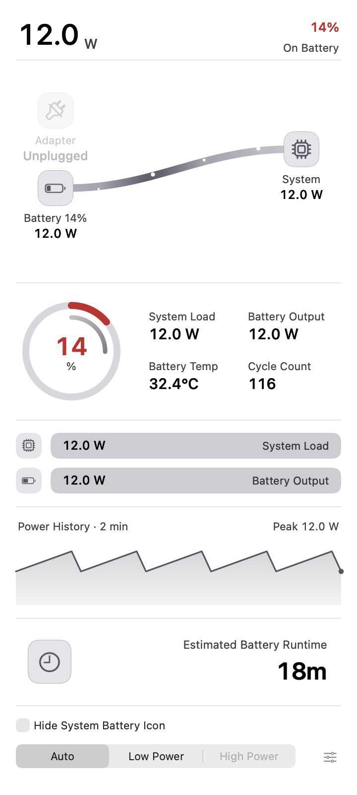</a></td><td><a href="runtime-section-dark-low-battery.png">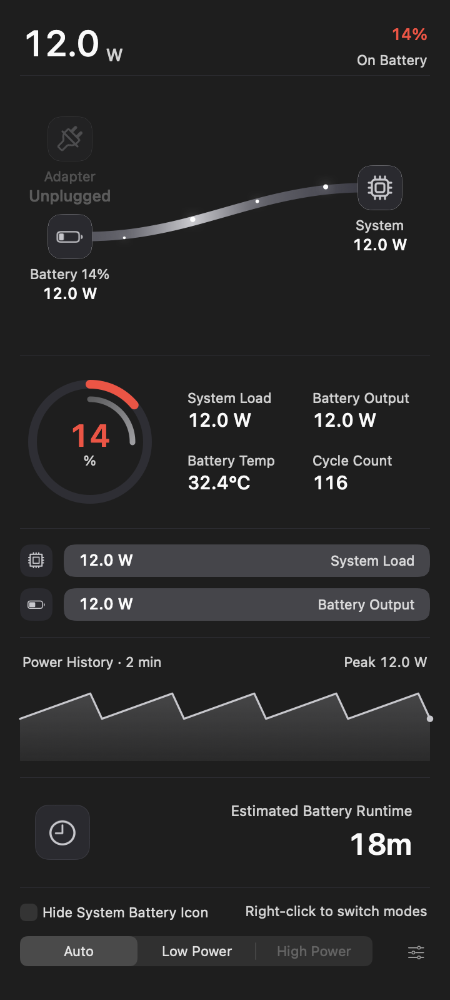</a></td></tr>
<tr><td colspan="2"><strong>Low Power</strong></td></tr>
<tr><td><a href="runtime-section-light-low-power.png">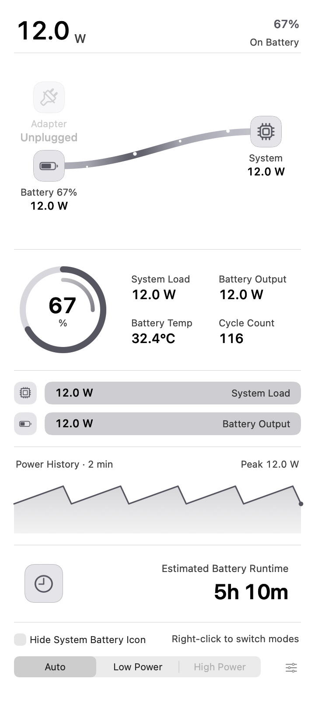</a></td><td><a href="runtime-section-dark-low-power.png">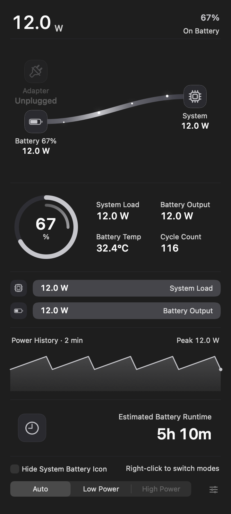</a></td></tr>
</table>

The [capture harness](../../../tests/visual/capture_runtime_sections.swift) passed 315 assertions across these twelve cases, including battery-time direction and state text, numeric/status typography, placement, text fitting, separators, visibility changes, and absence of a residual gap. The installed app, helper, preferences, and foreground application were unchanged during these fixture captures. This is local layout validation; hosted release and installation gates are verified separately.

[Checksums for all 13 images](SHA256SUMS.txt).
