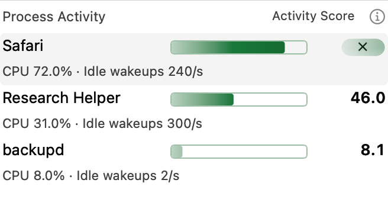
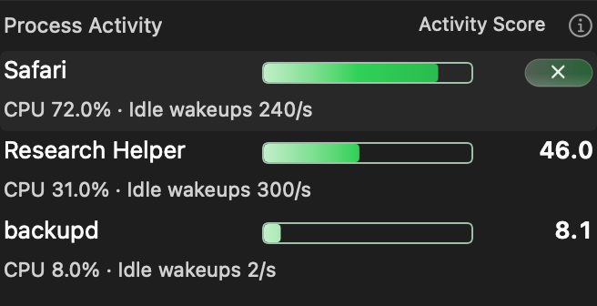
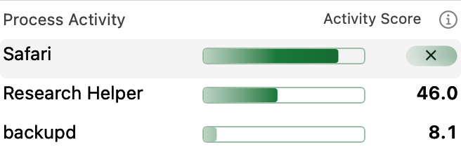
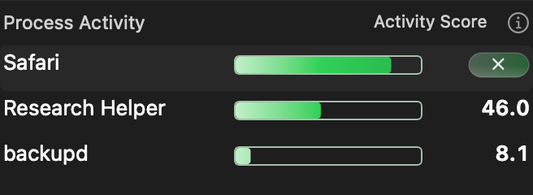
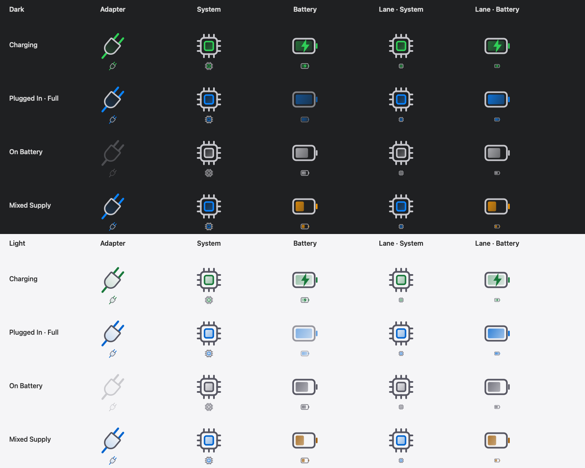

# Wattson 4.3.22 · approved design gallery

This versioned gallery presents the approved icon artwork included in Wattson
4.3.22. The five icon images are existing native **offscreen artwork proofs**, copied
unchanged from the approved design sources. Four Process Activity images are
fresh offscreen renders of the 4.3.22 production view with fixed fixtures. They are not running-app screenshots,
composited Liquid Glass captures, live telemetry or animation demonstrations.
The icon artwork is retained from 4.3.19. The new Process Activity pair shows
the selected uniform action capsule with the current charging palette. The
Ring Gauge metric selector is not pictured.

## Process Activity · Light / Dark

| Mode | Light | Dark |
| --- | --- | --- |
| Detailed |  |  |
| Compact |  |  |

These view-owned renders select Safari using a synthetic eligible identity. Its
score is replaced by the 38 × 16-point action capsule; other names, bars and
scores retain their positions. The charging `PowerSnapshot` supplies the same
App chart palette as the host. The renderer verifies the capsule dimensions and
that its tint equals the full 0–100 bar's deepest endpoint, independently of the
selected process's score. Activity Score combines CPU usage and idle wakeups;
it is not measured watts or a percentage of battery consumption.

The fixtures (84, 46 and 8.1) are illustrative, not live workloads. No app,
window, preference, helper read or termination request is created. These bitmap
proofs do not demonstrate composited native glass or pointer glow motion.
`bash design/releases/v4.3.22/render-previews.sh` owns and cleans its compiler
cache and executable through the shared lifecycle helpers.

## Light / Dark artwork

The Settings proofs pair **Dark above Light**, with enlarged and actual-size
artwork. The sidebar proof adds a white emphasized-selection row below them.

Six Modules masters: Energy Flow, Ring Gauge, Power Lanes, Power History,
Battery Time and Process Activity. The original five-icon family is retained
alongside the approved horizontal Process Activity symbol.

General, Display and Modules navigation artwork, including emphasized selection.

Launch at Login, System Battery Icon, Check for Updates, Automatic Updates and
Send Feedback.

## Power state matrix

The Power proofs use the production Flow and Lane drawing paths with fixed
fixtures. Both pair **Dark above Light**. The full matrix includes Charging,
Plugged In · Full, On Battery, Mixed Supply, Low Battery and Low Power.
Charging green, plugged-in blue, mixed-supply battery-assistance amber and neutral
disconnected styling retain their separate roles. The matrix shows enlarged
artwork and its actual 32/16-point display canvases.

## Editable SVG originals

- [Six Modules icons](Wattson-v4.3.22-Modules-SVG.zip)
- [Three sidebar icons](Wattson-v4.3.22-Sidebar-SVG.zip)
- [Five General icons](Wattson-v4.3.22-General-SVG.zip)
- [Five Power icons](Wattson-v4.3.22-Power-SVG.zip)

The four deterministic ZIPs contain the **19 current approved runtime SVG
masters**, copied byte-for-byte from the release source, and a version-labeled
contents file. The Power package contains Adapter, Battery, Charging,
Disconnected and System masters; the runtime supplies appearance/state colors.
These vector-only masters contain no embedded bitmaps, fonts or external assets.
The earlier Pro concept files remain in the repository's original design folder.

[manifest.json](manifest.json) records every source path, copy hash and package
hash. [SHA256SUMS.txt](SHA256SUMS.txt) covers the gallery resources.
`python3 design/releases/v4.3.22/prepare-assets.py` records the rendered previews
and reproduces final icon copies and ZIPs without a scratch app, temporary workspace or system changes.

[Public gallery](https://laleoarrow.github.io/battery-monitor/design/v4.3.22/) ·
[Release and installation guidance](https://github.com/laleoarrow/battery-monitor/releases/tag/v4.3.22)

Design assets are separate from the four checksum-gated installer release assets.
The Pages exporter copies this directory to `docs/design/v4.3.22/` for the
version-matched stable release; no website source change is required.
