# Wattson 4.3.3 — battery-time fallback layout fixtures

These twelve images use the production AppKit renderer from [`57eaaca`](https://github.com/laleoarrow/battery-monitor/commit/57eaaca370b205e51413fc6b9a1f5a1e38d5bbfd), captured on 2026-10-15 in a disposable ARM macOS 26.6.1 virtual machine. They show **Classic** with **Reduce Transparency** and **Reduce Motion**, rendered from hidden windows.

**Every power reading, history trace, battery-time value, source label, and footer helper/mode state is a fixed test sample. These are not live battery measurements, installed-app screenshots, or composited Liquid Glass captures.** No product source was changed for capture, no local-desktop test UI was launched, and no helper was installed or hardware power mode changed.

The independent battery-time section remains below Power History, with inset separators and right-aligned text. `≈` distinguishes the load-based discharge fallback; the battery-gauge charging estimate keeps ordinary time formatting. The fixture values illustrate presentation only and do not claim this Mac's real runtime or charging speed.

| Sample | Fixed time/source |
| --- | --- |
| On battery | `≈3h 0m`, observed-discharge fallback |
| Charging | `19m`, battery-gauge estimate |
| Full | `Fully Charged`, system state |
| Mixed supply | `Not Charging`, system state |
| Low battery | `≈20m`, observed-discharge fallback |
| Low Power | `≈5h 10m`, observed-discharge fallback; no mode multiplier |

The footer receives a fixed “helper available” state through its existing production `update` API, as in the footer tests. Auto is selected except in the Low Power sample. The VM reports no High Power capability, so that control remains disabled. These choices exercise rendering; they are not evidence of a helper installation or physical power-mode switch. Click an image to view full size.

<table>
<tr><th>Light</th><th>Dark</th></tr>
<tr><td colspan="2"><strong>Observed-discharge fallback</strong></td></tr>
<tr><td><a href="runtime-section-light-battery.png">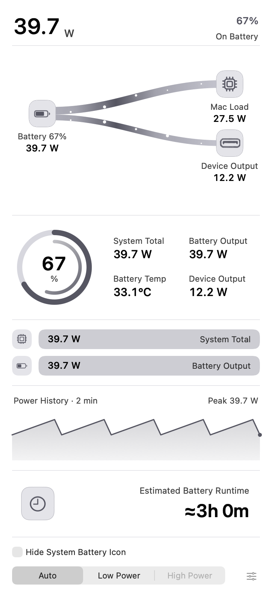</a></td><td><a href="runtime-section-dark-battery.png">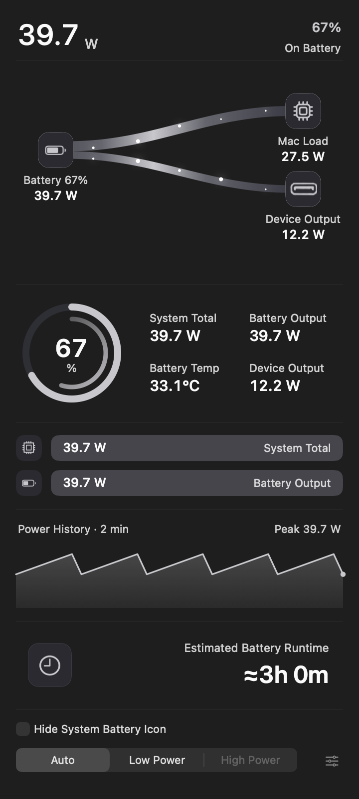</a></td></tr>
<tr><td colspan="2"><strong>Battery-gauge charging estimate</strong></td></tr>
<tr><td><a href="runtime-section-light-charging.png">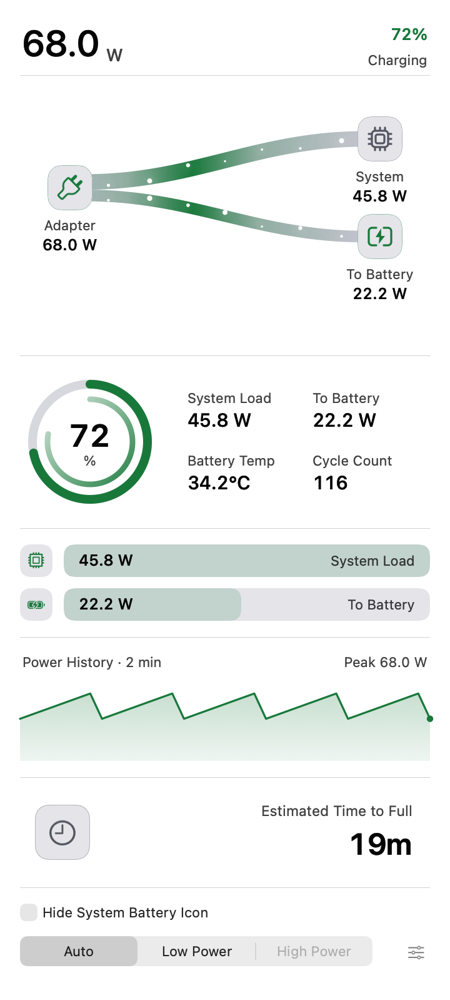</a></td><td><a href="runtime-section-dark-charging.png">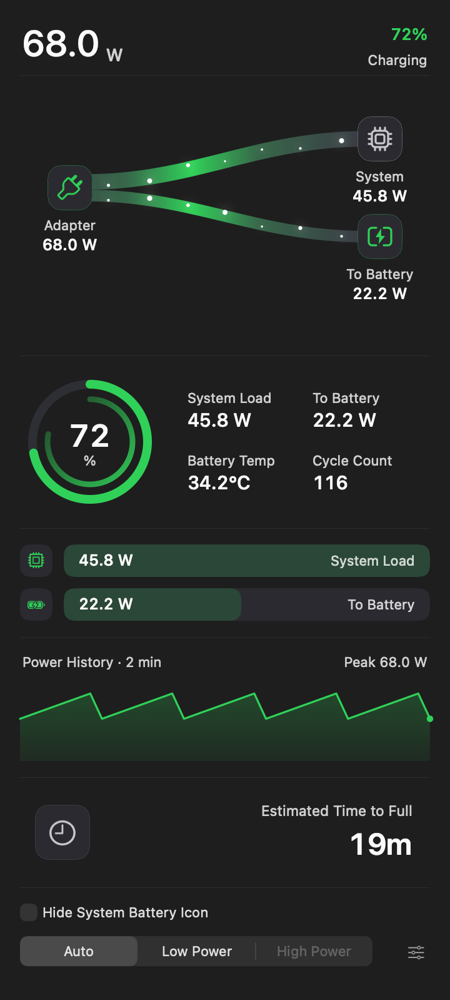</a></td></tr>
<tr><td colspan="2"><strong>Full</strong></td></tr>
<tr><td><a href="runtime-section-light-full.png">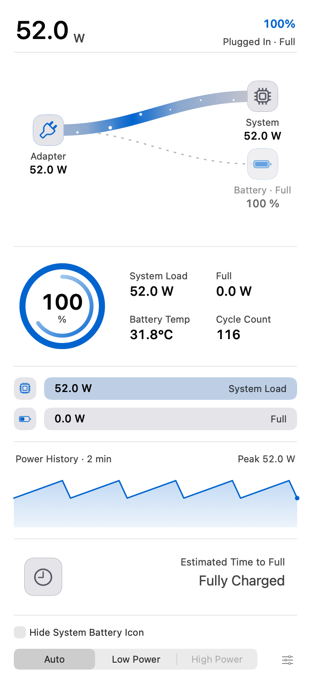</a></td><td><a href="runtime-section-dark-full.png">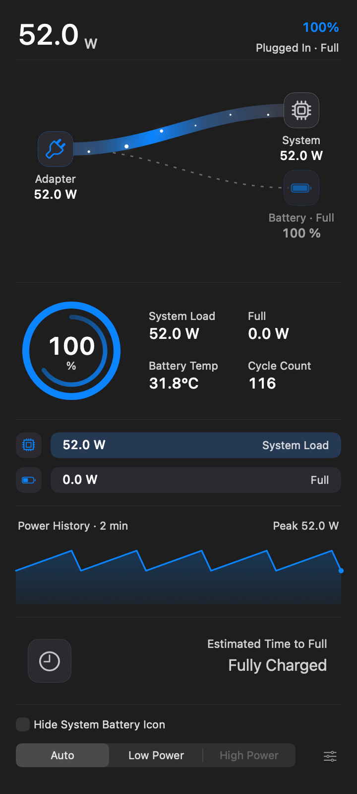</a></td></tr>
<tr><td colspan="2"><strong>Mixed supply</strong></td></tr>
<tr><td><a href="runtime-section-light-mixed.png">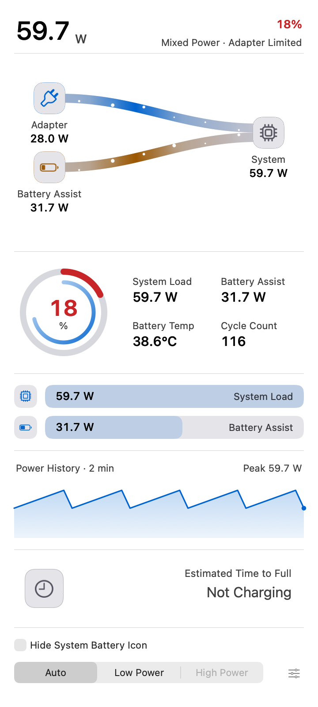</a></td><td><a href="runtime-section-dark-mixed.png">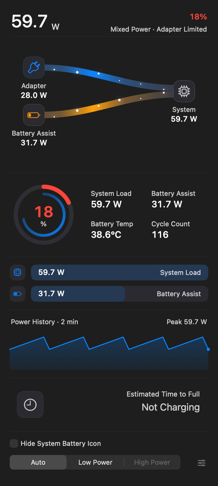</a></td></tr>
<tr><td colspan="2"><strong>Low battery</strong></td></tr>
<tr><td><a href="runtime-section-light-low-battery.png">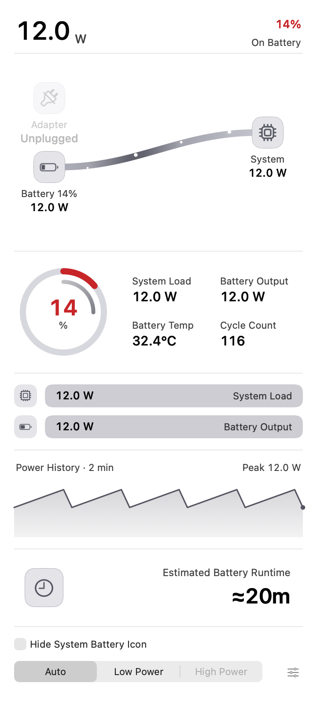</a></td><td><a href="runtime-section-dark-low-battery.png">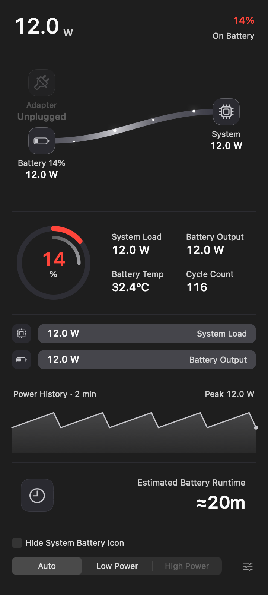</a></td></tr>
<tr><td colspan="2"><strong>Low Power</strong></td></tr>
<tr><td><a href="runtime-section-light-low-power.png">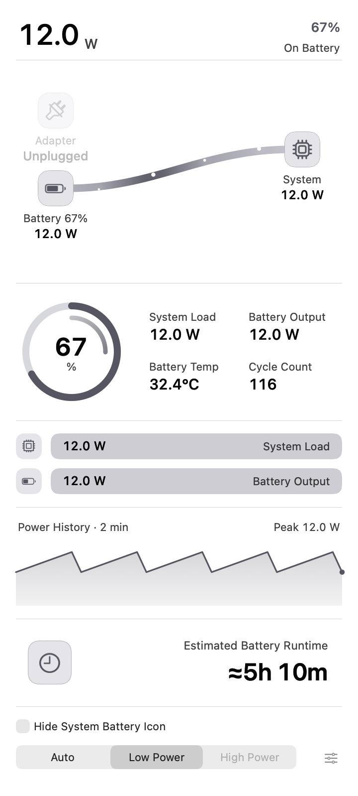</a></td><td><a href="runtime-section-dark-low-power.png">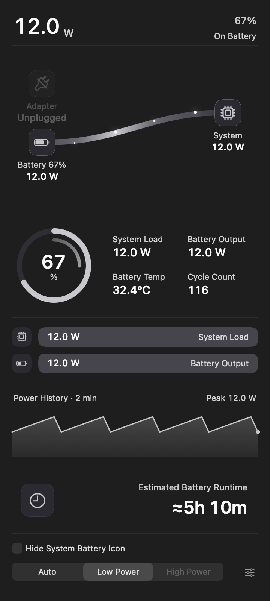</a></td></tr>
</table>

The capture harness passed **315 assertions with zero failures**, covering all twelve fixed samples: exact time text, type size, text fitting, 88-point section height, separators, placement, module hiding, and absence of leftover gaps. Guest app/helper/preference files and its foreground application remained unchanged. The temporary capture executable and guest source directory were removed after execution, and the VM was stopped.

Reproduction uses the [existing harness](../../../tests/visual/capture_runtime_sections.swift) plus the [fixture-only patch](capture-fixtures.patch), compiled with the frozen production `Core/*.swift`, `MenuBar/*.swift`, and `Popover/*.swift` files using `-D DEBUG -parse-as-library` and the AppKit/CoreGraphics/IOKit frameworks. Run only inside a disposable GUI VM with `WATTSON_FORCE_REDUCE_TRANSPARENCY=1 WATTSON_FORCE_REDUCE_MOTION=1`. The patch changes sample data and footer display inputs only.

[Capture manifest and source hashes](capture-manifest.json) · [SHA-256 image checksums](SHA256SUMS.txt)
