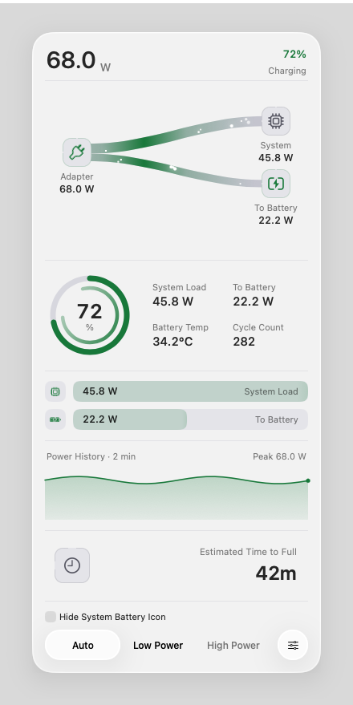
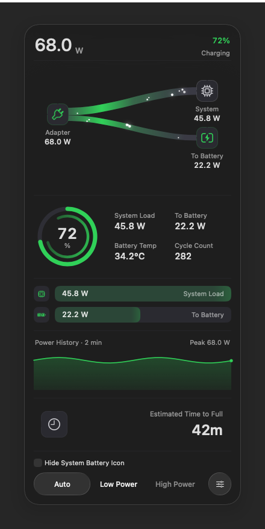
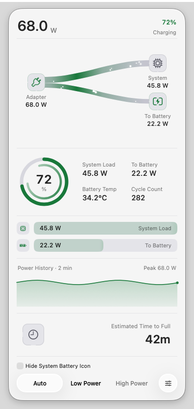
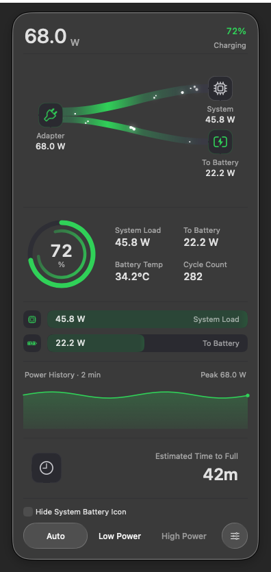
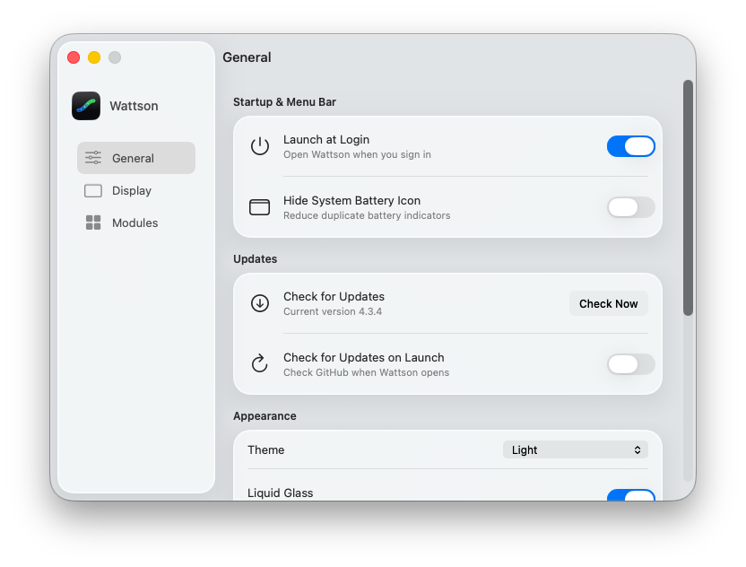
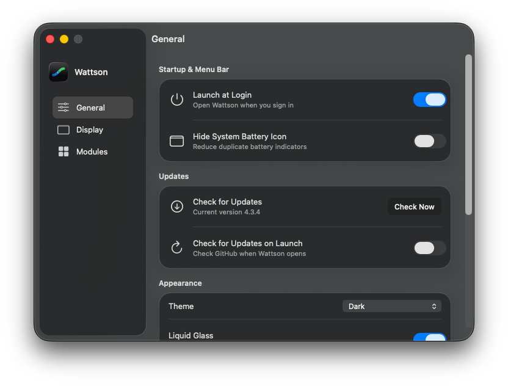
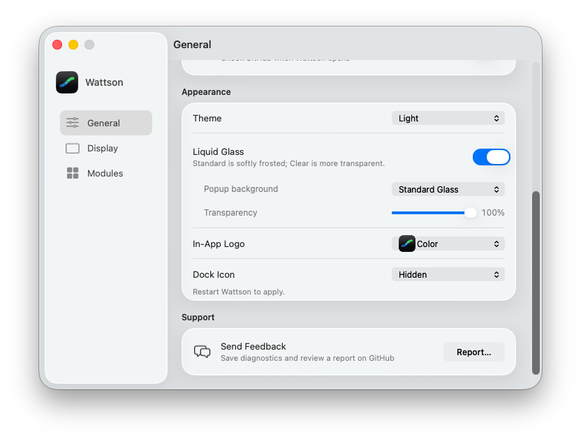
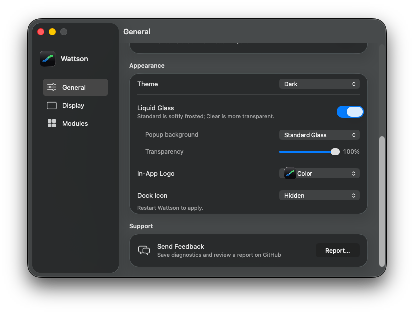
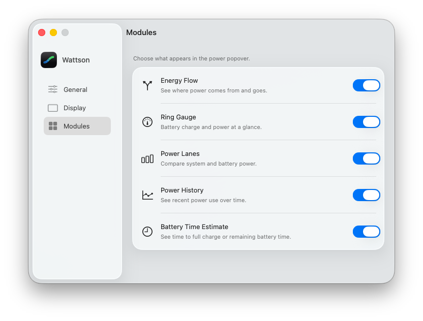
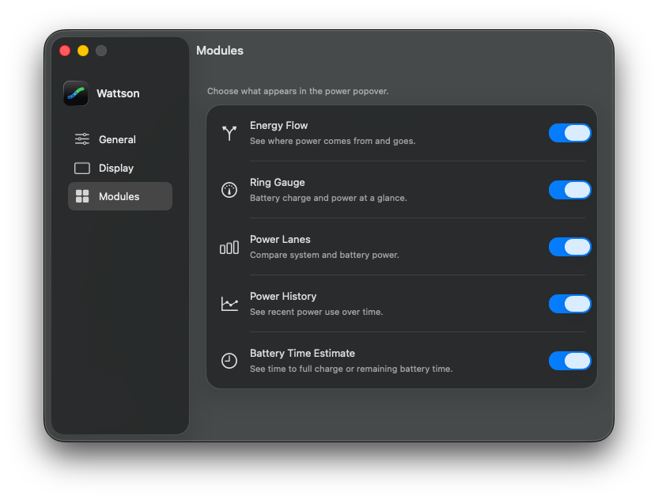

# Wattson 4.3.4 — popup and Settings gallery

This gallery combines the Issue #19 popup changes with the quieter Settings navigation. Popup images use the production window host from [`615c65e`](https://github.com/laleoarrow/battery-monitor/commit/615c65ec25f9bb54047e62b5d6fe174e90b75457), rendered through WindowServer in a disposable ARM macOS 26.6.1 (25G76) VM. The Settings captures use that same combined source revision and display version 4.3.4.

**Power readings, time estimates, history and footer mode/helper states are fixed test samples. These are real rendered windows, not live hardware readings or screenshots of an installed release PKG.** The VM has no internal battery. This gallery does not establish that the reporter's macOS 27.0.1 problem is resolved; Issue #19 remains open for Cody's confirmation.

## Popup: Light and Dark

Standard Glass uses a larger transparent window margin for its native material edge. The independent time section stays below Power History with separators and right-aligned text; the footer retains its glass mode capsules. Clear Glass retains the native window shadow. The four images below share a charging fixture: 72%, 68 W input and 42 minutes to full.

<table>
<tr><th>Light</th><th>Dark</th></tr>
<tr><td colspan="2"><strong>Standard Glass</strong></td></tr>
<tr><td></td><td></td></tr>
<tr><td colspan="2"><strong>Clear Glass</strong></td></tr>
<tr><td></td><td></td></tr>
</table>

## Six power states

All six scenarios use the real Standard Glass popup host and native status-item anchor. The charging image is reused from the table above; no duplicate PNG is stored. The low-power fixture selects Low Power through the existing footer display API. No real helper operation or power-mode switch is implied.

| State | Fixed battery/time display | Image |
| --- | --- | --- |
| Charging | 72%, `42m` to full | [Dark](standard-charging-dark.png) |
| Full | 100%, `Fully Charged` | [Dark](standard-full-dark.png) |
| On battery | 67%, `4h 25m` remaining | [Dark](standard-battery-dark.png) |
| Mixed supply | 72%, `Not Charging` | [Dark](standard-mixed-dark.png) |
| Low battery | 8%, `22m` remaining | [Dark](standard-low-battery-dark.png) |
| Low Power | 41%, `3h 30m` remaining | [Dark](standard-low-power-dark.png) |

## Settings: Light and Dark

These fresh macOS 26.6.1 VM captures use the production Settings renderer from the same combined source, with version 4.3.4. Sidebar glyphs are monochrome, selection is subdued, and the body typography follows the smaller hierarchy. Test preferences are in memory, with mock system/helper/update operations.

<table>
<tr><th>Light</th><th>Dark</th></tr>
<tr><td colspan="2"><strong>General</strong></td></tr>
<tr><td></td><td></td></tr>
<tr><td colspan="2"><strong>Appearance</strong></td></tr>
<tr><td></td><td></td></tr>
<tr><td colspan="2"><strong>Modules</strong></td></tr>
<tr><td></td><td></td></tr>
</table>

[Earlier complete 18-image Settings evidence](../../settings/quiet-navigation/CAPTURE-README.md) includes Display, Classic and Increase Contrast. Its Settings source is byte-for-byte identical (`511d566f0e8ff7ebb33dd27b3eb81a0235e5c22197868da4aebbfb6aaa22497e`); its General version row still reads 4.3.3 because those images preceded packaging. The historical image bytes are unchanged.

## Capture evidence

Popup capture uses the production [window probe](../../../tests/visual/capture_production_glass.swift) with a [fixture-only patch](capture-fixtures.patch) to select the six power samples. It captures only its own popup and backdrop. Production panel geometry, placement and sibling frames are unmodified. The manifest records each image's source, hash, pixel size and geometry checks.

[Capture manifest](capture-manifest.json) · [Image checksums](SHA256SUMS.txt) · [Issue #19](https://github.com/laleoarrow/battery-monitor/issues/19)
