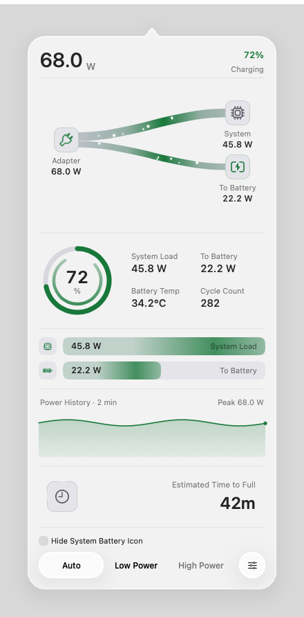
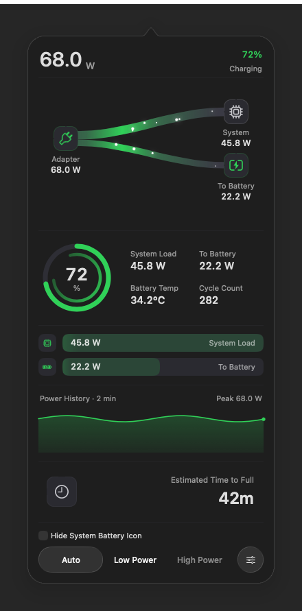
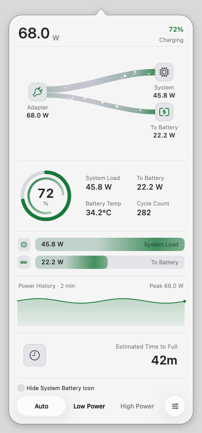
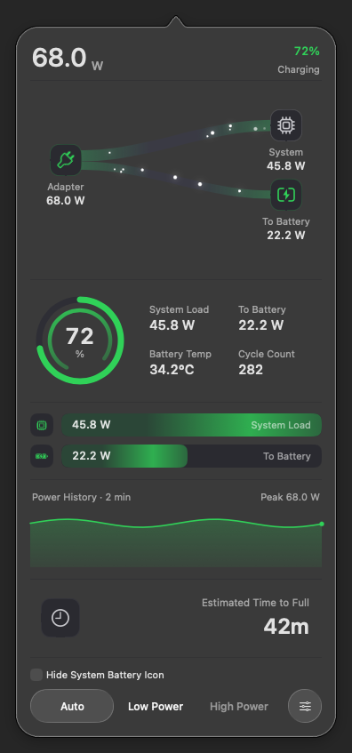
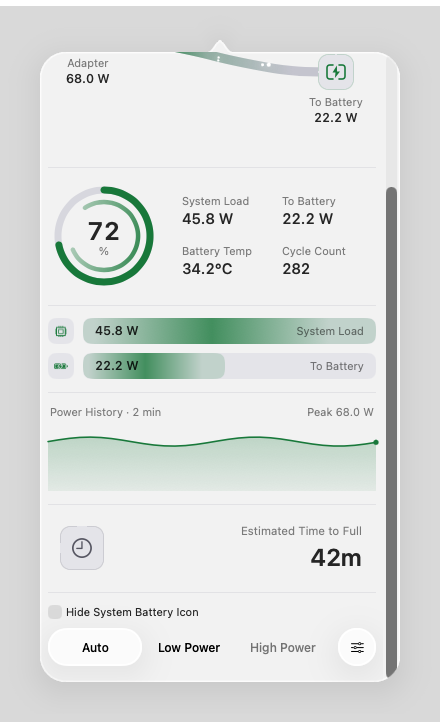

# Wattson 4.3.5 — continuous Liquid Glass popup outline

The popup arrow now shares one continuous native Liquid Glass shape with the body. It tracks the menu-bar battery icon and, at extreme screen edges, clamps before the rounded corners. Placement uses `tipY = min(anchor.minY, visibleFrame.maxY) - 4` in AppKit points, normally placing the tip about 4 points below the menu-bar edge. The time section stays below Power History, with right-aligned text and inset separators; the footer keeps its glass mode capsules.

These are production-window, WindowServer captures from a disposable ARM macOS 26.6.1 (25G76) VM. **Power readings, time estimates, history and helper/footer states are fixed test samples. They are not live hardware measurements or screenshots of an installed release PKG.** The VM has no internal battery. This gallery does not validate the reporter's macOS 27.0.1 environment; [Issue #20](https://github.com/laleoarrow/battery-monitor/issues/20) and [Issue #23](https://github.com/laleoarrow/battery-monitor/issues/23) await Cody's confirmation.

Capture includes only the popup and its fixed owned backdrop, covering the full screen behind the optical margin. A backdrop calibration prevents capture-boundary bands above the popup. These images exclude the real menu-bar content. The PNGs are unedited and uncropped.

## Standard and Clear: Light and Dark

The four images use the same charging sample: 72%, 68 W adapter input and 42 minutes to full. The arrow and body use one native material; the foreground remains an AppKit sibling above it so the footer retains its own interactive material.

<table>
<tr><th>Light</th><th>Dark</th></tr>
<tr><td colspan="2"><strong>Standard Glass</strong></td></tr>
<tr><td></td><td></td></tr>
<tr><td colspan="2"><strong>Clear Glass</strong></td></tr>
<tr><td></td><td></td></tr>
</table>

## Six power states

All six scenarios use the production Standard Glass popup and native status-item anchor. The charging image above is reused. Low Power is selected through the existing footer display API; these samples do not invoke helper operations or change a hardware power mode.

| State | Fixed battery/time display | Image |
| --- | --- | --- |
| Charging | 72%, `42m` to full | [Dark](standard-charging-dark.png) |
| Full | 100%, `Fully Charged` | [Dark](standard-full-dark.png) |
| On battery | 67%, `4h 25m` remaining | [Dark](standard-battery-dark.png) |
| Mixed supply | 72%, `Not Charging` | [Dark](standard-mixed-dark.png) |
| Low battery | 8%, `22m` remaining | [Dark](standard-low-battery-dark.png) |
| Low Power | 41%, `3h 30m` remaining | [Dark](standard-low-power-dark.png) |

## Short screen

This Standard/Light capture uses a 1024 × 768 screen and scrolls to the bottom. Foreground content stays within the rounded body, while the time section and glass footer remain reachable.

## Shape, placement and input checks

The backing fill follows the same outline as the native material, including its arrow. A minimum backing opacity of 1/255 inside that outline preserves WindowServer input coverage; the outer optical margin stays transparent. The production probe checks their aligned frames, the 12-point arrow/content separation, screen-constrained placement and menu-bar anchor. It also checks transparency and solid accessibility fallbacks, plus a short-screen scroller with reachable time and footer sections. The manifest records the individual results and source hashes.

A transparent rounded foreground wrapper clips scrolling content to the popup body, preventing flow lines and text from escaping into the arrow or optical margin on short screens. Glass and backing remain siblings of that wrapper, preserving the footer's native material. Detaching the shared content leaves Classic's root clipping unchanged.

An independent native-material/custom-shape comparison caught a transparent blank-area input regression during development. The backing opacity floor fixes that input region; only captures from the final source revision recorded in the manifest are included here.

At five status-item positions, the probe compares WindowServer hit-query results with the closed-popup baseline. A separate body-center calibration and 35-point body grid must all identify the popup window. These queries check that the body accepts input while the transparent optical margin does not capture those menu-bar mouse-down targets. They do **not** inject OS mouse events or establish Cody's repeated-click result. Real AppKit action-path tests remain separate from these static captures.

The settled-menu fixture requires a non-nil presentation layer whose opacity and transform match the model layer, a key window and the full settings circle to be visible before its first padding click. It retains the one-second timeout and original click assertions; entrance motion is tested separately. Earlier input, fixture-readiness and capture-boundary failures are retained in the private review evidence rather than counted as final passes.

The screenshots and 20,000-iteration stress result come from [`12a6614`](https://github.com/laleoarrow/battery-monitor/commit/12a6614402f58aba052daf0738ad5db83615be1b). The revised interaction fixture at [`65574a4`](https://github.com/laleoarrow/battery-monitor/commit/65574a4693ba8a1e8e6881cbcd3a5c54c1572f2a) passed 1,686 AppKit assertions across five VM configurations, including all presentation-readiness and original padding-click checks. [Hosted CI on that revision](https://github.com/laleoarrow/battery-monitor/actions/runs/38740051530) passed 437 Swift tests and 560 Python tests with four expected skips. Production code, the actual capture program and C bridge, and the stress harness remain byte-identical to their captured source; the interaction fixture is recorded separately. Earlier captures from before the clipping fix are retained privately and are not included here. VM headless Swift tests were unavailable because its Command Line Tools lacks XCTest; headless results belong to hosted CI.

## Public API references

Apple's [`glassEffect(_:in:)`](https://developer.apple.com/documentation/swiftui/view/glasseffect(_:in:)) accepts a SwiftUI `Shape`; Wattson uses it for the joined arrow/body outline. [`NSGlassEffectView`](https://developer.apple.com/documentation/appkit/nsglasseffectview) exposes [`cornerRadius`](https://developer.apple.com/documentation/appkit/nsglasseffectview/cornerradius) rather than a custom-shape parameter, so only the background uses this small hosting bridge. The foreground and window lifetime remain in AppKit.

Apple documents that [`NSWindow.windowNumber(at:belowWindowWithWindowNumber:)`](https://developer.apple.com/documentation/appkit/nswindow/windownumber(at:belowwindowwithwindownumber:)) uses mouse-down hit-testing rules, including transparency and windows that ignore mouse events. That is the scope of the baseline queries recorded here.

[Capture manifest](capture-manifest.json) · [Image checksums](SHA256SUMS.txt) · [Fixture-only patch](capture-fixtures.patch)
