# Wattson 4.3.6 — pointer-following footer reflections

The main popup's power-mode buttons and round settings button gain a quiet reflection that follows the pointer across their surface and rim. It also appears over the selected glass capsule. The existing glass or Classic surfaces, geometry and actions stay in place. The reflection follows Light and Dark appearance, fades away when the pointer leaves and respects Reduce Motion. Disabled modes, the gap and the outside corners do not glow. Settings-window buttons and the system-battery checkbox are outside this change.

These are production-window, WindowServer captures from a disposable ARM macOS 26.6.1 (25G76) VM. **Power readings, time estimates, history and helper/footer states are fixed test samples. They are not live hardware measurements or screenshots of an installed release PKG.** The VM has no internal battery. The fixture sends real OS mouse events through WindowServer and native tracking, without setting a DEBUG pointer position. It retains the production activation and keyboard-focus behavior.

Full-popup images and footer-only images are separate native captures. The capture API receives the requested screen rectangle directly; static PNGs are not subsequently cropped, edited, composited or generated. Only the production popup and its owned fixed backdrop are included, without unrelated desktop or menu-bar content. Each APNG contains 37 actual successive native frames at their recorded intervals. Their original compressed pixel data is preserved, without generated frames, color changes or a drawn pointer.

## Real pointer movement

These loops show the surface and rim reflection following a real OS pointer sweep. Auto remains selected during all three sweeps; hovering over Low Power does not select it. The native capture excludes the cursor image; the actual pointer coordinates and timestamps are recorded in each animation's verification JSON. The Light reflection remains subtle against its white glass surface.

<table>
<tr><th>Standard Glass · Dark</th><th>Standard Glass · Light</th></tr>
<tr><td colspan="2"><strong>Selected Auto capsule</strong></td></tr>
<tr><td>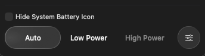</td><td>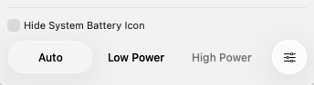</td></tr>
<tr><td colspan="2"><strong>Unselected Low Power button</strong></td></tr>
<tr><td>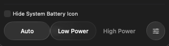</td><td>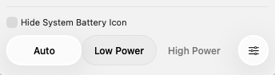</td></tr>
<tr><td colspan="2"><strong>Round settings button</strong></td></tr>
<tr><td>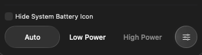</td><td>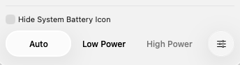</td></tr>
</table>

The six animations retain all 222 native frames. Decoding every APNG frame to RGBA produces the same ordered SHA-256 hashes as the original PNG sequence. Each frame interval matches its recorded timestamp within one microsecond. [The encoder](encode-native-sweep.py) records individual PNG/pixel hashes, native capture rectangles, pointer coordinates, timestamps and APNG delay fractions in the accompanying `*-sweep.json` files. Raw frames remain in the explicit private QA evidence; no redundant frame ZIP is published.

## Existing surfaces and layout

The charging sample uses 72%, 68 W adapter input and 42 minutes to full. The time section remains below Power History, with right-aligned text and inset separators. Hover adds a reflection over the retained control surface; it does not replace the existing selected capsule.

<table>
<tr><th>Light</th><th>Dark</th></tr>
<tr><td colspan="2"><strong>Standard Glass</strong></td></tr>
<tr><td><a href="standard-charging-light.png">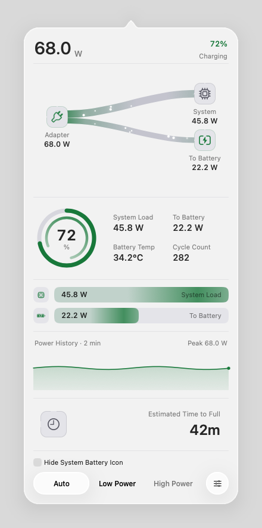</a></td><td><a href="standard-charging-dark.png">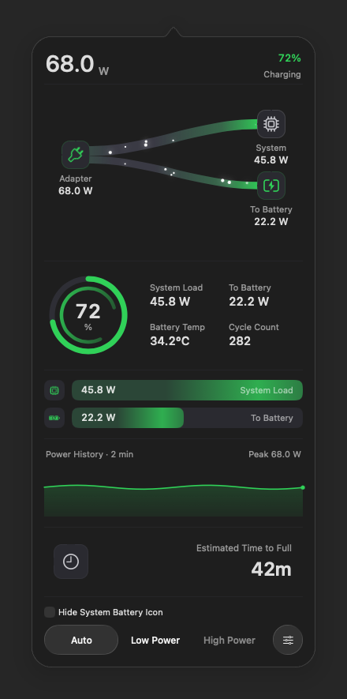</a></td></tr>
<tr><td colspan="2"><strong>Clear Glass</strong></td></tr>
<tr><td><a href="clear-charging-light.png">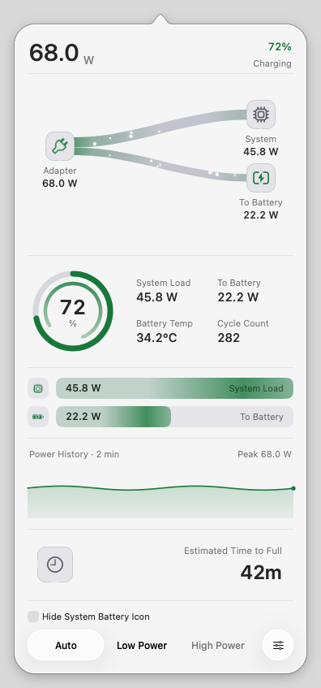</a></td><td><a href="clear-charging-dark.png">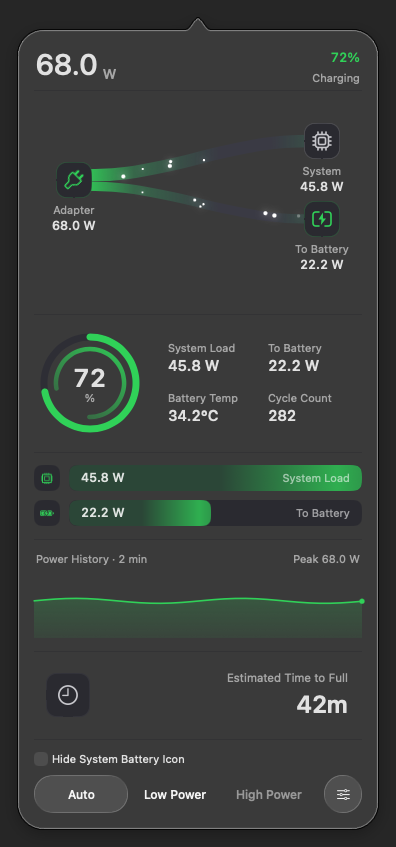</a></td></tr>
<tr><td colspan="2"><strong>Classic</strong></td></tr>
<tr><td><a href="classic-charging-light.png">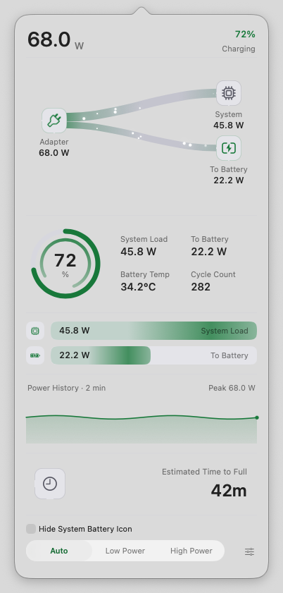</a></td><td><a href="classic-charging-dark.png">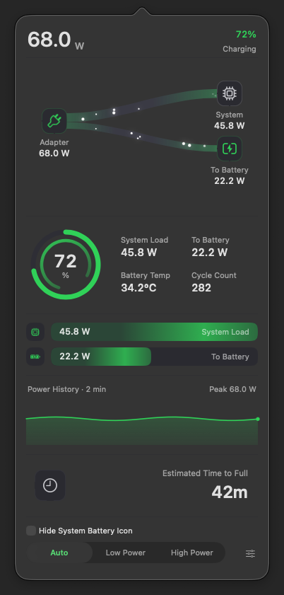</a></td></tr>
</table>

The following are separate native footer captures, showing entry and exit without changing the selection:

| Pointer state | Native footer image |
| --- | --- |
| Outside before entry | [Before](standard-dark-before-footer.png) |
| Over Low Power | [Hovered mode](standard-dark-low-footer.png) |
| Over the settings circle | [Hovered settings](standard-dark-menu-footer.png) |
| Outside after exit | [After exit](standard-dark-out-footer.png) |

## Six power states

All six fixed samples use the production Standard Glass popup in Dark appearance. The Low Power sample starts with Low Power selected; the other samples start with Auto selected. The later click test changes the fixture selection through a stub completion, without invoking helper operations or changing a hardware power mode.

| State | Fixed time display | Image |
| --- | --- | --- |
| Charging · 72% | `42m` to full | [Dark](standard-charging-dark.png) |
| Full · 100% | `Fully Charged` | [Dark](standard-full-dark.png) |
| On battery · 67% | `4h 25m` remaining | [Dark](standard-battery-dark.png) |
| Mixed supply · 72% | `Not Charging` | [Dark](standard-mixed-dark.png) |
| Low battery · 12% | `24m` remaining | [Dark](standard-low-battery-dark.png) |
| Low Power · 48% | `3h 40m` remaining | [Dark](standard-low-power-dark.png) |

## Accessibility and fallback controls

These are separately exercised configurations on the same macOS 26 VM, not a complete OS/appearance/accessibility cross-product. The legacy knob is forced through its existing test setting; it is not evidence of a separate macOS 12 machine.

| Configuration | Production control path | Image |
| --- | --- | --- |
| Glass · Reduce Motion · Dark | Native glass buttons | [View](glass-reduce-motion-dark.png) |
| Glass · Reduce Transparency · Light | Native glass buttons and solid material fallback | [View](glass-reduce-transparency-light.png) |
| Glass · Increase Contrast · Dark | Native glass buttons | [View](glass-increase-contrast-dark.png) |
| Classic · Reduce Motion · Dark | Native segmented control | [View](classic-reduce-motion-dark.png) |
| Classic · legacy knob · Dark | Classic slider | [View](classic-legacy-dark.png) |

## Verification scope

All gallery media comes from the same frozen production source, [`7e376e4`](https://github.com/laleoarrow/battery-monitor/commit/7e376e4a525998212a378e149c5d0393f6a3b918), and the final capture-tool revision recorded in the manifest. The final native matrix passed 16 configurations, producing 80 full-popup captures, 80 direct footer captures and 555 raw sweep frames. This gallery selects 16 full images, four static footer images and six animations. Earlier diagnostic failures and preview captures are retained privately and are not counted as this final pass.

For every configuration, real OS pointer events exercise Auto, Low Power and the settings circle; disabled High Power, gaps and outside corners remain unlit. A real mode click and settings click each deliver exactly one intent. Hiding and reopening clears stale hover. Classic's first hover is exercised while the app is inactive and its popup is not key; the change does not globally enable `acceptsMouseMovedEvents`. A fresh owned backdrop is independently calibrated to uniform opaque RGBA before capture, avoiding a capture-boundary band without modifying the PNGs.

The frozen source passed 462 Swift tests and 560 Python tests with four expected skips locally. The same production revision passed the test and website jobs in both [branch CI](https://github.com/laleoarrow/battery-monitor/actions/runs/38765161151) and [PR CI](https://github.com/laleoarrow/battery-monitor/actions/runs/38765169530). Release-main and installer-candidate gates are separate from this gallery.

The separate AppKit regression passed 1,686 assertions across five configurations: native 339, legacy knob 337, Reduce Motion 333, Reduce Transparency 338 and Increase Contrast 339. The 20,000-iteration animation stress run also passed. Probe and regression wrappers and outer runners exited zero. Cleanup passed all eight checks both immediately and after an independent 126.76-second quiet period, with empty runtime-residual lists. The disposable VM remains idle for subsequent installer-candidate validation.

[Issue #20](https://github.com/laleoarrow/battery-monitor/issues/20) and [Issue #23](https://github.com/laleoarrow/battery-monitor/issues/23) remain subject to Cody's confirmation on the reported macOS version; this hover review does not establish their closure.

[Capture manifest](capture-manifest.json) · [Media checksums](SHA256SUMS.txt) · [Lossless sweep encoder](encode-native-sweep.py)
