# Wattson 4.3.7 — system battery-icon read states

The system battery-icon control now distinguishes **Reading…** from a completed
**Status Unavailable** result. A successful later read restores the checkbox.
The existing Standard Glass footer capsules and light/dark themes remain in use.

These are **native WindowServer captures of production AppKit windows** in a
throwaway ARM macOS 26.6.1 (25G76) GUI VM. The charging reading, time
estimate and displayed helper read states are fixed fixtures, with the verified
public 4.3.6 helper present in the VM. They are not readings from Cody's macOS 27
machine or screenshots of an installed 4.3.7 release PKG.

The popup and footer images are separate native captures. The footer rectangle
was requested directly from the WindowServer API; none of the PNGs was cropped,
recolored, composited afterward or generated. The neutral background belongs to
the capture harness.

## Footer states

| State | Light | Dark |
| --- | --- | --- |
| First read: **Reading…**; checkbox unavailable while the read is pending. | 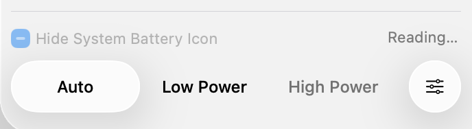 | 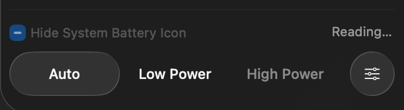 |
| Settled read failure: **Status Unavailable**; checkbox remains disabled. | 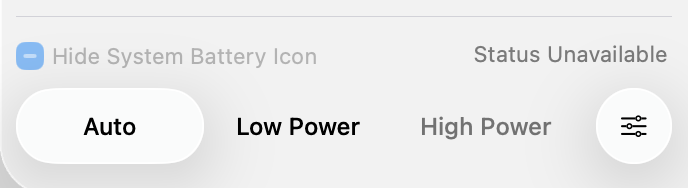 | 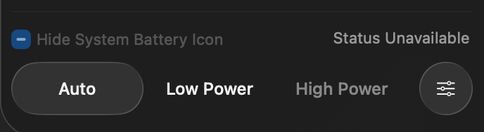 |
| Recovery: the read returned **hidden = false**; status text disappears and the unchecked checkbox becomes available. | 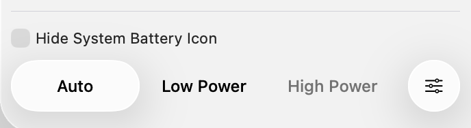 | 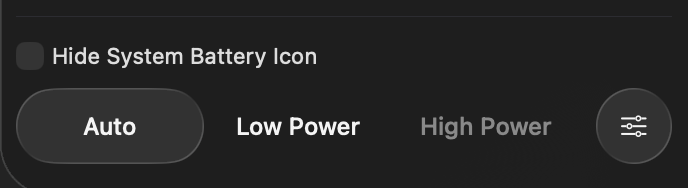 |

## Popup windows — bottom-scrolled viewport

The VM screen is 1024 × 768 logical points. Each popup is scrolled to the bottom
so its footer is visible; the upper power-flow content is outside this viewport.
These images show the visible window, not the entire unscrolled document.
The fixed charging example shows 72% battery and an estimated **42 minutes to
full**. The independent time section remains below Power History and above the
glass footer controls.

| State | Light | Dark |
| --- | --- | --- |
| Reading | 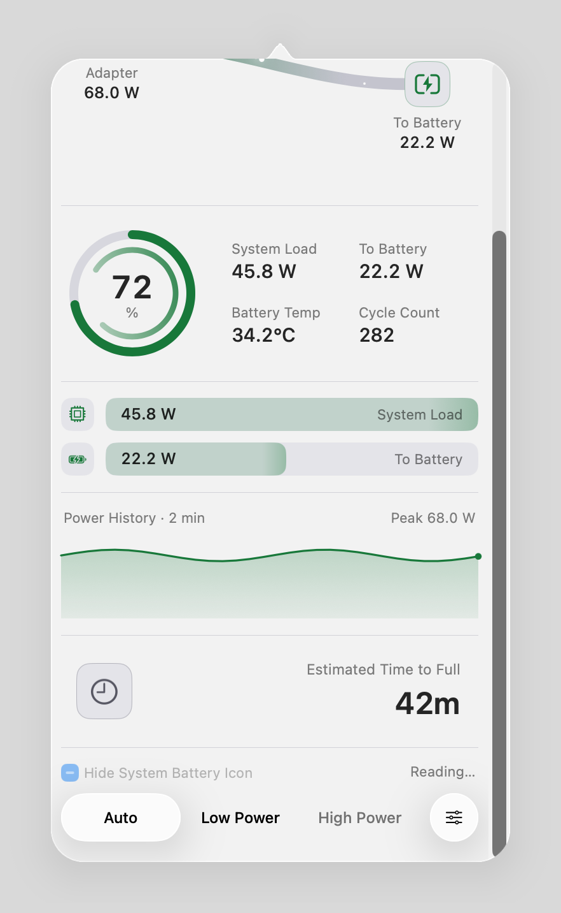 | 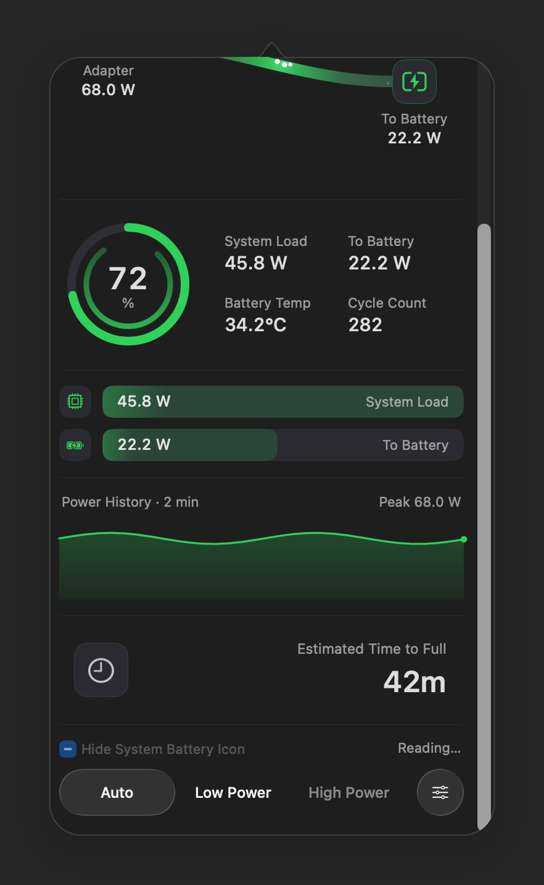 |
| Unavailable | 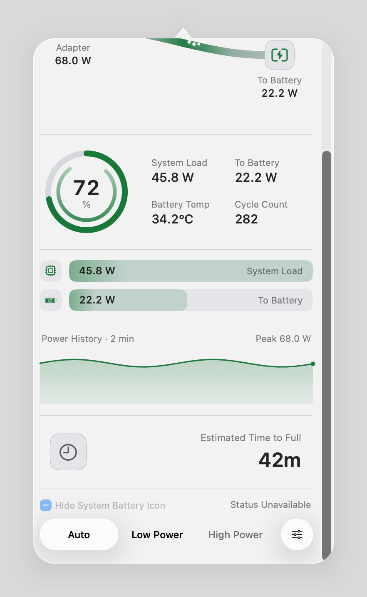 | 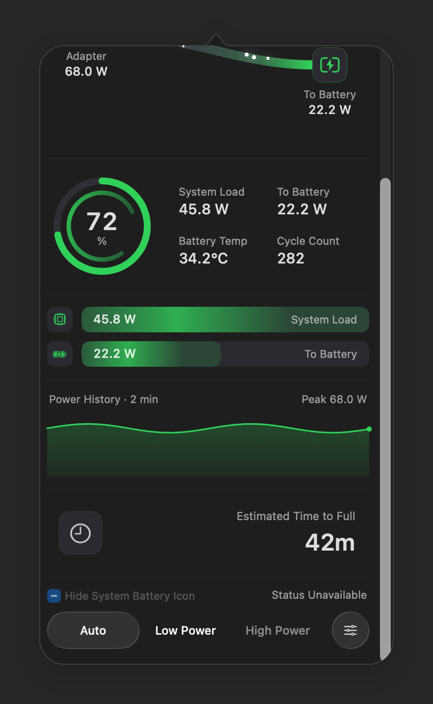 |
| Recovered | 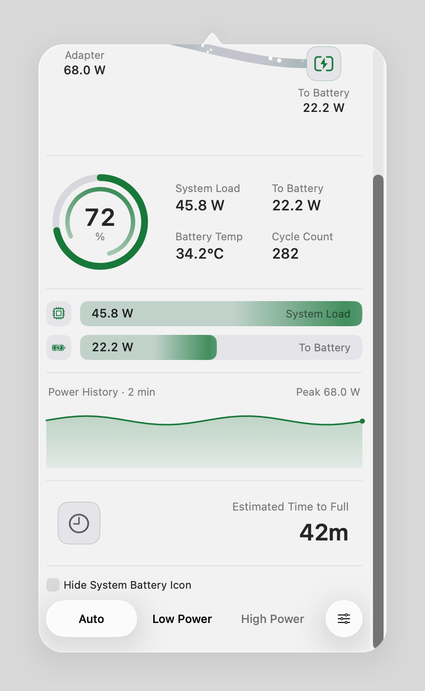 | 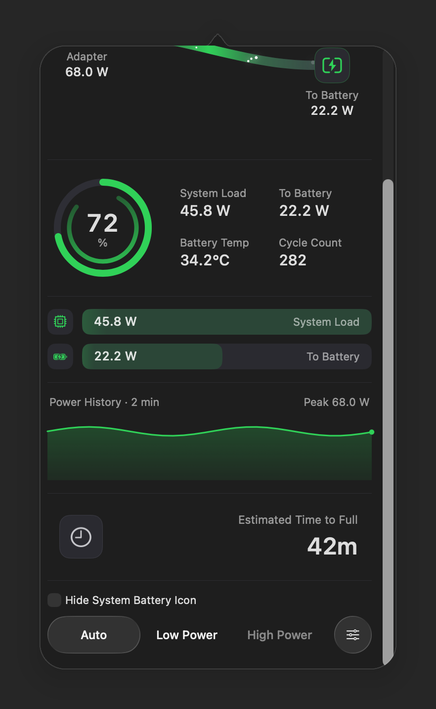 |

## Evidence scope

- Production capture revision: [`b76606a0e8e88d7bde8b7a80080eee040ecf5d7e`](https://github.com/laleoarrow/battery-monitor/commit/b76606a0e8e88d7bde8b7a80080eee040ecf5d7e).
- The selected images cover three read states in both appearances. Read-state
  labels, checkbox values and unchanged layout geometry were recorded alongside
  each native capture, with the read state asserted again after compositing.
  This gallery does not demonstrate write operations or cross-window race
  handling by itself.
- The capture harness and its outer wrappers completed successfully. Release
  installer checks, hosted CI and other release gates are separate evidence.
- Related source QA on the same VM passed 1,736 AppKit assertions across five
  configurations, eight Settings contract tests including 500-window stress,
  20,000 animation-stress iterations, and 315 runtime-layout assertions across
  12 cases. The runtime-layout checks use separate hidden-window Classic bitmap
  captures; they are not the WindowServer screenshots displayed here.
- An independent cleanup audit after **105.966 seconds** of inactivity
  passed all eight owned-resource checks and all eight installation-cleanup
  checks. The disposable VM was retained for later candidate validation.
  These source-QA results do not establish final public-PKG installation success.
- [Issue #20](https://github.com/laleoarrow/battery-monitor/issues/20) Standard/Clear
  arrow behavior and [Issue #23](https://github.com/laleoarrow/battery-monitor/issues/23)
  spacing still need Cody's confirmation on the reported system.
- [Capture manifest](capture-manifest.json) records source/tool hashes, native
  rectangles, dimensions and observed controls; [SHA-256 checksums](SHA256SUMS.txt)
  cover all gallery images and documentation.
