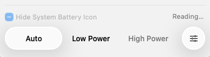
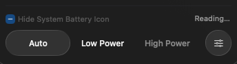
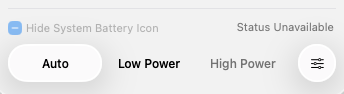
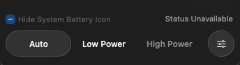
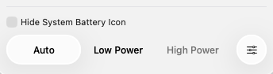
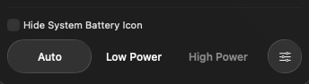

# Wattson4.3.8：系统电池图标读取状态

读取中显示 `Reading…`；明确失败后显示 `Status Unavailable`。读取恢复后，复选框按当前状态恢复可用。

这组图来自4.3.8生产AppKit窗口在macOS26.6.1 ARM测试虚拟机中的原生合成，使用固定充电数据和注入的读取状态。完整窗口和底部区域均直接捕获，PNG未裁剪、重绘或调色。它们用于验证界面，不代表真实电池续航测量。

| 状态 | 浅色 | 深色 |
| --- | --- | --- |
| 读取中 |  [查看完整窗口](standard-light-checking.png) |  [查看完整窗口](standard-dark-checking.png) |
| 读取失败 |  [查看完整窗口](standard-light-failed-requestFailed.png) |  [查看完整窗口](standard-dark-failed-requestFailed.png) |
| 读取恢复 |  [查看完整窗口](standard-light-recovered-ready-false.png) |  [查看完整窗口](standard-dark-recovered-ready-false.png) |

底部保留原有模式按钮及设置圆钮；预计充满时间位于History下方，使用独立分割线。

源代码：[`207cef43`](https://github.com/laleoarrow/battery-monitor/tree/207cef43dd8214df880a6c55abf825719fa4c65e)。逐图捕获区域、像素尺寸与校验和见[manifest.json](manifest.json)和[SHA256SUMS.txt](SHA256SUMS.txt)。截图使用已验证的公开4.3.6 helper提供安装可用性，读取状态由测试控制器注入；4.3.8安装包另行验证。
