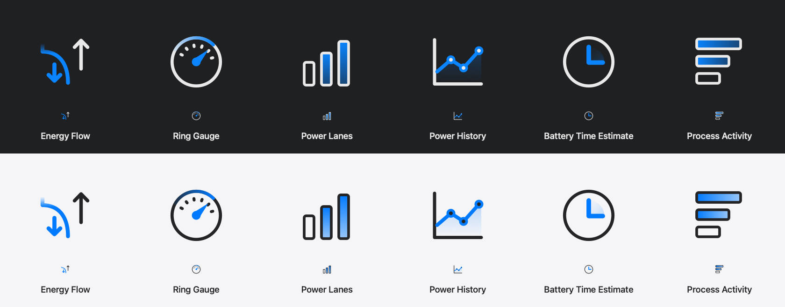
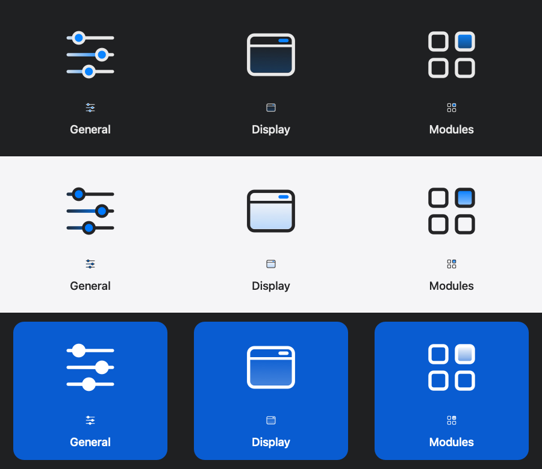

# Wattson 5.0.1 · approved design gallery

This versioned gallery presents the approved icon artwork included in Wattson
5.0.1. Its five images are existing native **offscreen artwork proofs**, copied
unchanged from the approved design sources. They are not running-app screenshots,
composited Liquid Glass captures, live telemetry or animation demonstrations.
The process-whitelist interface and performance changes are not pictured.

## Light / Dark artwork

The Settings proofs pair **Dark above Light**, with enlarged and actual-size
artwork. The sidebar proof adds a white emphasized-selection row below them.

Energy Flow, Ring Gauge, Power Lanes, Power History, Battery Time and Process
Activity. The original five-icon family is retained alongside the approved
horizontal Process Activity symbol.

General, Display and Modules navigation artwork, including emphasized selection.

Launch at Login, System Battery Icon, Check for Updates, Automatic Updates and
Send Feedback.

## Power state matrix

The retained Power proofs use the production Flow and Lane drawing paths with
fixed fixtures. Both pair **Dark above Light**. The full matrix includes Charging,
Plugged In · Full, On Battery, Mixed Supply, Low Battery and Low Power.
Charging green, plugged-in blue, mixed-supply battery-assistance amber and neutral
disconnected styling retain their separate roles. The matrix shows enlarged
artwork and its actual 32/16-point display canvases.

## Editable SVG originals

- [Six Modules icons](Wattson-v5.0.1-Modules-SVG.zip)
- [Three sidebar icons](Wattson-v5.0.1-Sidebar-SVG.zip)
- [Five General icons](Wattson-v5.0.1-General-SVG.zip)
- [Five Power icons](Wattson-v5.0.1-Power-SVG.zip)

The four deterministic ZIPs contain the **19 current approved runtime SVG
masters**, copied byte-for-byte from the release source, and a version-labeled
contents file. Native drawing paths supply appearance and state colors. The
vector-only masters contain no embedded bitmaps, fonts or external assets.

[manifest.json](manifest.json) records every source path, copy hash and package
hash. [SHA256SUMS.txt](SHA256SUMS.txt) covers the gallery resources.
`python3 design/releases/v5.0.1/prepare-assets.py` reproduces the final copies and
ZIPs without an app, temporary workspace or system changes.

[Public gallery](https://laleoarrow.github.io/battery-monitor/design/v5.0.1/) ·
[Release and installation guidance](https://github.com/laleoarrow/battery-monitor/releases/tag/v5.0.1)

Design assets remain separate from the four checksum-gated installer assets.
The existing Pages exporter copies this directory to `docs/design/v5.0.1/` for
the version-matched stable release and preserves earlier versioned galleries.
