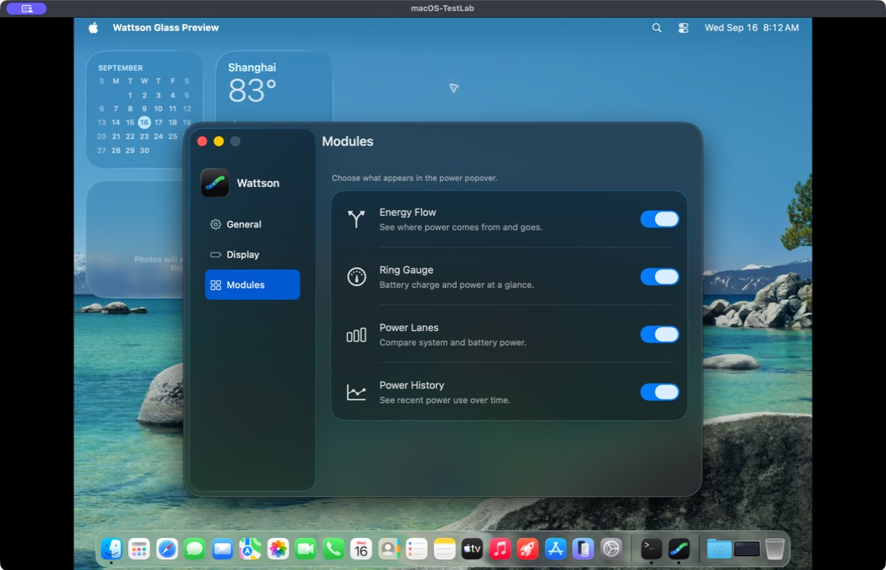

# Continuous Settings backdrop — 16 September 2026

The previous revision left a dark backing strip around the floating sidebar.
Its behind-window material started near the sidebar's trailing edge, exposing
the opaque window background along the top, leading and bottom edges.

Glass Settings now uses a clear window background and extends the existing
behind-window material to the full detail view, which AppKit lays out beneath
the sidebar. The sidebar remains the native floating `NSSplitViewItem` with
its system glass, corners and shadow. No extra material or custom outline was
added. Classic retains its original opaque background.

This follows Apple's edge-to-edge content guidance for native floating
sidebars in [Build an AppKit app with the new design](https://developer.apple.com/videos/play/wwdc2025/310/).

## Actual window

Unedited capture of the production Settings controller in the isolated preview
app on `macOS-TestLab` (macOS 26.6.1). Preferences and helper operations are mocked.
Compare with the [previous Modules capture](../native-window-chrome/modules-dark.jpg).

Additional unedited captures: [General, Dark](general-dark.jpg),
[General, Light](general-light.jpg), [Display, Light](display-light.jpg),
and [Classic, Light](classic-light.jpg).

## Verification

The source snapshot and logs are in `dist/settings-continuous-backdrop-20260916/`.
The preview is built from immutable `source-v1.tar.gz` with warnings as errors.
Swift: 356 tests passed. Python: 494 tests run, 490 passed and four existing
opt-in skips. All eight Settings contract tests pass, including coverage of
the full-window backdrop, clear backing, native sidebar, toolbar, focus and
Classic restoration.

All eight Settings tests also pass with real GUI interaction enabled in the
VM, including native close/minimize/reopen, keyboard focus, 500 reuse cycles
and 500 new-controller release checks. Manual inspection verifies navigation,
titlebar dragging, Light/Dark appearance and the Glass/Classic round trip.
The VM source manifest verifies all 42 compiled/test source files without
mismatches. Preview SHA-256:
`6fac00fc1f8cecab4611085bf116c60a312ac0a6ceb909e4b49a178613674576`.

The canonical `/Applications/Wattson.app` is unchanged; this is a source
refinement, not an installation or release.
