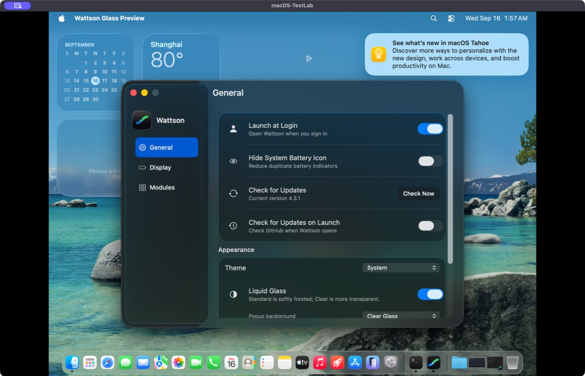

# Native Settings window chrome — 16 September 2026

The Finder reference exposed a structural difference: Wattson used a
titlebar-only window. Its compact traffic-light placement and smaller outer
corners did not enclose the floating sidebar like a unified-toolbar window.

Glass Settings now installs a native `NSToolbar` and `.unified` toolbar style.
AppKit determines the window corners and traffic-light spacing; the code never
repositions or redraws the standard window buttons. The sidebar extends behind
them, and its identity starts below the system safe area. The detail pane uses
its toolbar safe area. A tracking separator aligns the current page's title
with the detail column. The title has no button or glass backing, and the
duplicate inline heading is hidden. Classic restores its existing inline title
and compact layout when glass is disabled.

Following the user's clarification, the sidebar keeps an independent material
layer above the detail region. Its custom fill is clear. The behind-window
detail material underlaps the sidebar's trailing edge by the existing content
inset instead of filling the whole sidebar. The system window backing remains
visible around its curved edges. AppKit renders the sidebar's glass, border and
shadow; there is no custom blur, outline or shadow. This also prevents the
transparency preference from adding a duplicate fill inside the sidebar.

The functional group fills now use the same corner radius as their enclosing
glass, including at reduced transparency. The fixed-size Settings window still
has native close and minimize controls, with zoom disabled.

Primary references:

- [Apple: Adopting Liquid Glass](https://developer.apple.com/documentation/technologyoverviews/adopting-liquid-glass)
- [WWDC25: Build an AppKit app with the new design](https://developer.apple.com/videos/play/wwdc2025/310/), especially app structure, toolbar titles, sidebar safe areas and window concentricity.

## Actual windows

These unedited captures show the production Settings controller inside the
isolated preview app in `macOS-TestLab`. Preferences and privileged operations
are mocked. The desktop, widgets and welcome notification belong to the VM.

| Capture | Review |
| --- | --- |
| [General, Dark](general-dark.jpg) | Traffic lights inside the sidebar; native toolbar title |
| [Display, Dark](display-dark.jpg) | Updated title, caption and seven-state icon previews fit |
| [Modules, Dark](modules-dark.jpg) | Single title and rounded functional group |
| [General, Light](general-light.jpg) | The retained window follows its Light theme |
| [Classic, Light](classic-light.jpg) | Turning glass off restores the compact layout |

## Verification

The snapshot and logs live in `dist/settings-window-chrome-20260916/`.
The preview was built from `source-v6.tar.gz` with warnings as errors. Swift
passes 356 tests; Python runs 494 tests, with 490 passing and four existing
opt-in skips.
The Settings contract verifies native traffic-light clearance, toolbar titles
on all pages, shared group corners, Classic restoration, keyboard focus and
scrolling without extra helper requests. Manual VM interaction verifies the
native close button, titlebar dragging, navigation and Light/Glass switching.
The final scope additionally checks that the detail backdrop underlaps only
the sidebar edge and that the native sidebar's own custom fill stays clear.
All eight Settings tests also pass with real GUI interaction enabled in the
VM, including native close/minimize/reopen, keyboard focus, 500 reuse cycles
and 500 new-controller release checks. The final assertions finish in 114 s.
The immutable VM manifest verifies all 42 compiled/test source files with no
mismatches. Preview executable SHA-256:
`9d236edce5184f559a8a728b4c219c06b907b4ae4032d72bac8061d8641f83f6`.

This source revision does not update `/Applications/Wattson.app`, publish a
release, or change any signed installation assets.
