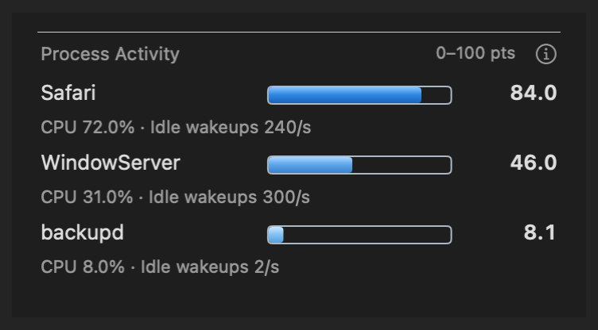
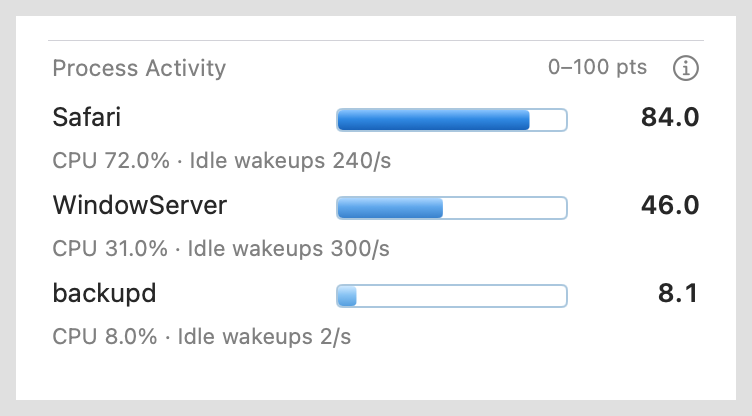

# Process Activity

The user-requested Pro redesign replaces the rejected thin relative bars with
a fixed scale, visible gradients and concrete CPU/wakeup readings. The new
native previews below are implementation review evidence; user approval is not
implied. The [Pro design specification](pro-design.md) records the direction
and the verified ChatGPT Pro consultation.

Development source based on Wattson 4.3.17. The canonical installed app and
helper are preserved; this review does not publish or install a release.

The independent module defaults to three processes. Settings > Modules
supports 1–10, visibility and the existing module ordering controls. Its icon
uses three horizontal bars, descending in length, with neutral outlines and
blue gradients. Process rows share Wattson's transparent surface and separators.

The fixed **0–100 pts** scale prevents an idle first-ranked process from filling
its bar. Each row shows its real activity points and the underlying CPU percent
and idle wakeups per second. Twelve-point bars use one blue color family,
progressing from pale to deep blue as the fixed-scale activity rises, with a
vertical highlight. A chevron at the bar's end marks scores above 100 without hiding the
numeric value. Zero remains empty and tiny values are not inflated. A small
native information button explains the formula, sampling and limitations.
These values are not watts or shares of measured battery power. See
[the data model and formula](../../docs/top-energy-processes.md).

## Native visual evidence

These images come from real AppKit renderers in an owned ARM GUI VM. Process
names and scores are fixed validation fixtures. The module-only images show
Classic views in an actual window with an opaque background; they are not a
demonstration of Liquid Glass translucency.

| Dark | Light |
| --- | --- |
|  |  |

[Supplied style reference](reference-style.png) ·
[Settings quantity control and horizontal icon](pro-settings-light.png)

[Actual Glass host](pro-glass-dark-bottom.png) ·
[Overflow](pro-overflow-dark.png) · [Tiny and zero values](pro-tiny-light.png) ·
[Information popover](pro-help-light.png)

The Modules list scrolls below its fixed subtitle and Restore button. Native
coordinate assertions cover focusing the quantity control at the bottom without
overlapping that header or clipping the row. Width checks use the native clip
view's available width, including the space reserved by legacy scrollbars.

The preceding Pro native matrix has 126 captures and 5,134 assertions with zero
failures. All 571 Swift tests and the universal macOS 12 build pass. One real
root-helper read returns the CPU/wakeup components consistently with the
activity formula. High-contrast colors are covered by component tests.
[Pro verification metadata](pro-verification.json) records the source/image hashes,
Python Settings-test correction, fixture limitations and build scope.

The single-blue-scale refinement keeps that layout, sampling and metric design.
Its fresh native module previews above are separate evidence for the changed
palette. The earlier [uniform-blue dark](pro-module-dark.png) and
[uniform-blue light](pro-module-light.png) captures remain available for comparison.
The refinement passes nine focused view tests, two native captures with 102
assertions, and a fresh universal macOS 12 build. The test preference domain
stays absent through 35 seconds of filesystem observation; all ten resource
checks pass and the disposable VM has been removed, preserving the original VMs.
[Final verification](verification.json) records these results and the new hashes.

## Earlier rejected candidate

The following images preserve the user's rejected thin-bar candidate. Its
highest-process normalization and thin fills are not the current design.

[Rejected dark module](module-dark.png) ·
[Rejected light module](module-light.png) ·
[Earlier Settings](settings-light.png)

## Reproduce

```sh
swift test
python3 -B -m unittest discover -s tests -v
bash scripts/build_release.sh
```

The explicit GUI entrypoints run in the disposable test VM:

```sh
WATTSON_RUN_GUI_TESTS=1 bash scripts/verify_top_processes.sh OUTPUT_DIRECTORY
WATTSON_RUN_GUI_TESTS=1 bash scripts/verify_top_processes.sh --module-only OUTPUT_DIRECTORY
bash scripts/verify_interaction.sh
bash scripts/verify_animation_stress.sh
```

The GUI scripts use the existing lifecycle helpers for exact test preference
domains, temporary bundles, child processes and app registrations. They do not
replace the canonical app or modify production user preferences.
