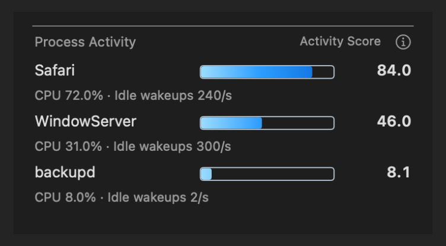
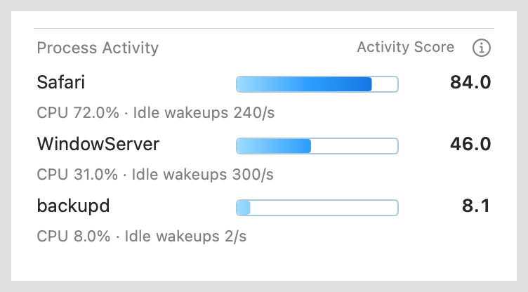
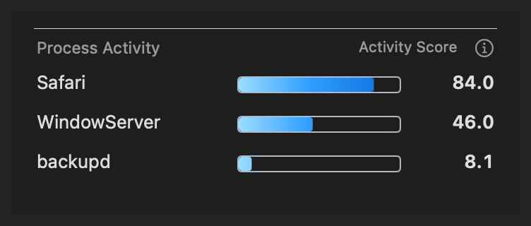
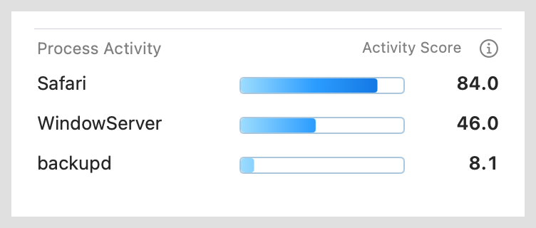

# Process Activity

The user-requested Pro redesign replaces the rejected thin relative bars with
a fixed scale, visible gradients and concrete CPU/wakeup readings. The new
native previews below are implementation review evidence. The user selected
fixed-scale horizontal option A from the four-style comparison.
The [Pro design specification](pro-design.md) records the earlier direction
and the verified ChatGPT Pro consultation.

Development source based on Wattson 4.3.17. The user subsequently requested
a local upgrade: **4.3.18** is now installed at `/Applications/Wattson.app`
together with its matching helper through the verified native PKG. See the
[installation record](local-installation-v4.3.18.json). This is a local candidate;
no public release is implied. Earlier verification records describe their
original pre-installation snapshots.

The independent module defaults to three processes. Settings > Modules
supports 1–10, visibility and the existing module ordering controls. Its icon
uses three horizontal bars, descending in length, with neutral outlines and
blue gradients. Process rows share Wattson's transparent surface and separators.

The fixed **0–100 Activity Score** scale prevents an idle first-ranked process from filling
its bar. Each row shows its real activity points and the underlying CPU percent
and idle wakeups per second. Each complete track has a horizontal gradient from
pale to deep blue; a mask reveals only the portion through the current score.
For example, 8.1 reveals only the pale first 8.1% of the gradient.
Rows use the same colors, while
length and the numeric **Activity Score** convey activity. A chevron at the
bar's end marks scores above 100 without hiding the
numeric value. Zero remains empty and tiny values are not inflated. A small
native information button explains Wattson's CPU-and-wakeup activity indicator
and the fixed scale; formula lineage is retained in developer documentation.
These values are not watts or shares of measured battery power. See
[the data model and formula](../../docs/top-energy-processes.md).

The optional **Compact view** switch in this module's Settings row hides the
CPU/wakeup line, reducing the default three-process section from 168 to 120
points. It preserves names, scores, bars, tooltips and accessibility details.
The switch defaults off and retains its value while the module is disabled.

## Native visual evidence

These images come from real AppKit renderers in an owned ARM GUI VM. Process
names and scores are fixed validation fixtures. The module-only images show
Classic views in an actual window with an opaque background; they are not a
demonstration of Liquid Glass translucency.

| Dark | Light |
| --- | --- |
|  |  |

| Compact, dark | Compact, light |
| --- | --- |
|  |  |

[Compact view setting](fixed-scale-gradient/settings-compact-light.png) ·
[Selected-style verification](fixed-scale-gradient/README.md)

[Supplied style reference](reference-style.png) ·
[Settings quantity control and horizontal icon](pro-settings-light.png)

[Earlier Glass host layout](pro-glass-dark-bottom.png) ·
[Earlier overflow](pro-overflow-dark.png) · [Earlier tiny and zero values](pro-tiny-light.png) ·
[Current information popover](horizontal-gradient-help-dark.png)

The Modules list scrolls below its fixed subtitle and Restore button. Native
coordinate assertions cover focusing the quantity control at the bottom without
overlapping that header or clipping the row. Width checks use the native clip
view's available width, including the space reserved by legacy scrollbars.

The preceding Pro native matrix has 126 captures and 5,134 assertions with zero
failures. All 571 Swift tests and the universal macOS 12 build pass. One real
root-helper read returns the CPU/wakeup components consistently with the
activity formula. High-contrast colors are covered by component tests.
[Pro verification metadata](pro-verification.json) records the source/image hashes,
Python Settings-test correction, fixture limitations and build scope.

The preceding per-score blue-tint interpretation passed nine focused view tests,
two native captures with 102
assertions, and a fresh universal macOS 12 build. The test preference domain
stays absent through 35 seconds of filesystem observation; all ten resource
checks pass and the disposable VM has been removed, preserving the original VMs.
[Its verification](blue-scale-review.json) preserves those results and hashes.
The user subsequently clarified that the gradient belongs inside each bar;
the preceding previews show that horizontal treatment and the final
Activity Score wording. Earlier [per-score dark](blue-scale-module-dark.png),
[per-score light](blue-scale-module-light.png), [uniform-blue dark](pro-module-dark.png)
and [uniform-blue light](pro-module-light.png) images remain historical evidence.
The preceding complete-fill horizontal gradient and Activity Score wording passed nine
focused view tests and three real-window captures with 107 assertions. The
information text fits its actual native text cell without clipping.
[Its verification](verification.json) records that source and evidence.

The subsequent [four-style gradient comparison](gradient-comparison/README.md)
adds the user's requested fixed 0–100 gradient that reveals only the portion
through the current value, alongside the three earlier treatments. These are
DEBUG review alternatives. The user selected A; the current renderer and compact
option are documented in [the selected-style review](fixed-scale-gradient/README.md).

## Earlier rejected candidate

The following images preserve the user's rejected thin-bar candidate. Its
highest-process normalization and thin fills are not the current design.

[Rejected dark module](module-dark.png) ·
[Rejected light module](module-light.png) ·
[Earlier Settings](settings-light.png)

## Reproduce

```sh
swift test
python3 -B -m unittest discover -s tests -v
bash scripts/build_release.sh
```

The explicit GUI entrypoints run in the disposable test VM:

```sh
WATTSON_RUN_GUI_TESTS=1 bash scripts/verify_top_processes.sh OUTPUT_DIRECTORY
WATTSON_RUN_GUI_TESTS=1 bash scripts/verify_top_processes.sh --module-only OUTPUT_DIRECTORY
WATTSON_RUN_GUI_TESTS=1 bash scripts/verify_top_processes.sh --compact-only OUTPUT_DIRECTORY
bash scripts/verify_interaction.sh
bash scripts/verify_animation_stress.sh
```

The GUI scripts use the existing lifecycle helpers for exact test preference
domains, temporary bundles, child processes and app registrations. They do not
replace the canonical app or modify production user preferences.
