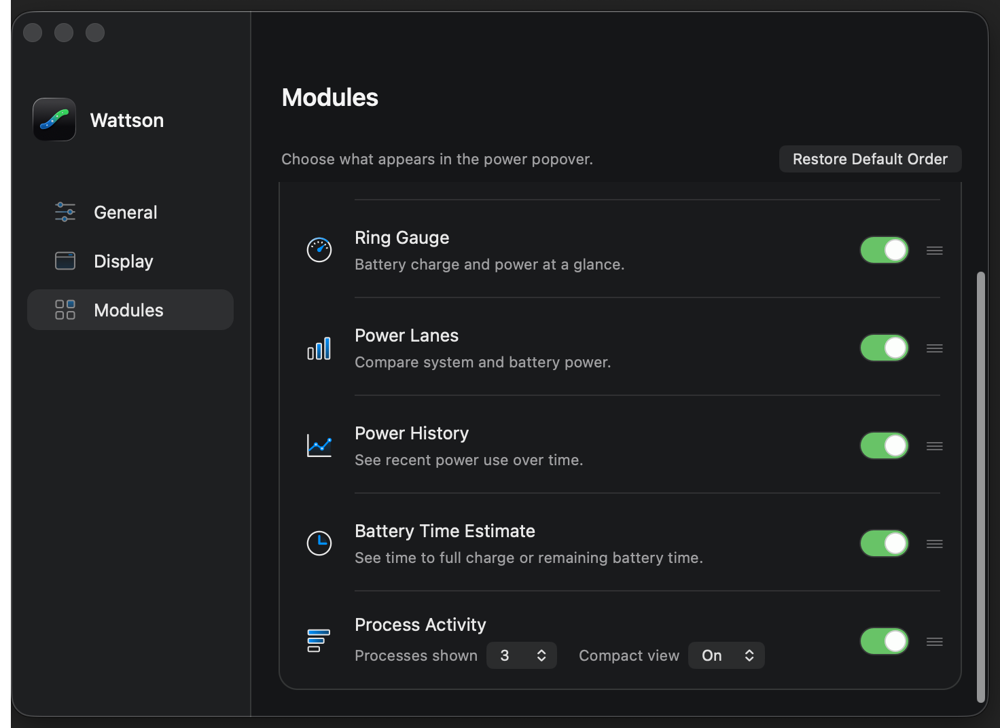
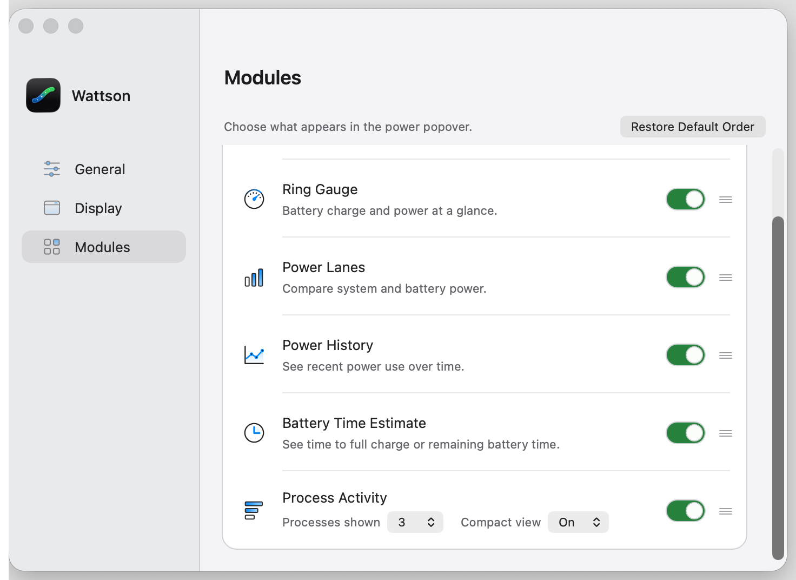
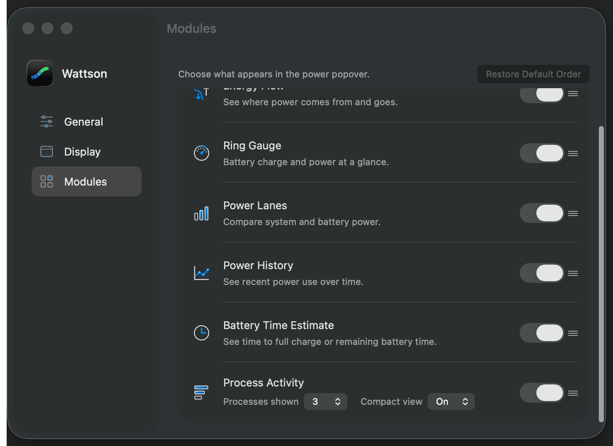
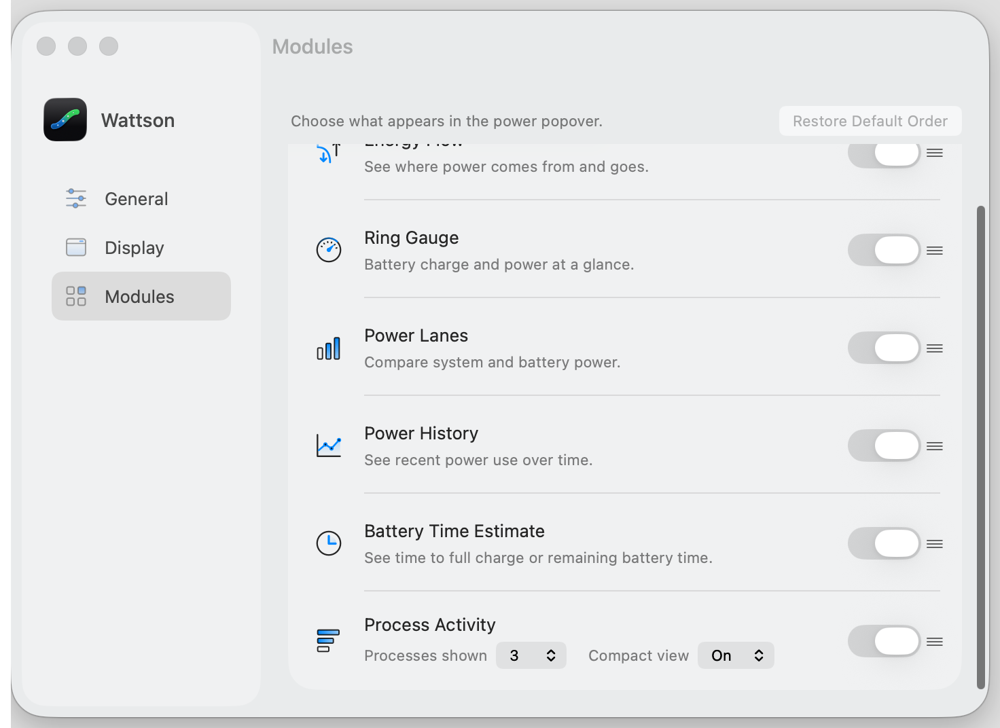

# Compact view selector

The user's installed-app review rejected the large Compact view switch.
Compact view now uses the same small `SettingsAppearancePopupButton` as the
adjacent Processes shown selector, with Off and On options. Both use the same
small control size, detail font and native appearance. The module's main
visibility switch retains its established presentation.

This changes the control only. The stored `popover.topProcessesCompact` Bool,
default, process count, A gradient, sampling and compact row geometry retain
their existing behavior. The selector preserves the current choice, disables
with its module and follows count → compact → module switch in the keyboard loop.

The four native Settings captures cover Classic and Liquid Glass in light and
dark appearances using the actual production Settings renderer in an owned
disposable ARM GUI VM. Settings dependencies are deterministic fixtures.

| Classic, dark | Classic, light |
| --- | --- |
|  |  |

| Glass, dark | Glass, light |
| --- | --- |
|  |  |

The preceding [fixed-scale review](../fixed-scale-gradient/README.md) retains
the unchanged process-renderer validation. The present control verification
does not repeat that six-state process matrix.

## Verification and local installation

All eight Settings-window contract checks pass. The native run passes 96
assertions across four full windows and four directly captured control rows.
Both selectors use 20-point height, the small control size and an 11-point font.
The 35-second preference observation and ten resource checks pass; the owned VM
has been deleted. See [verification.json](verification.json).

The verified universal PKG is installed as **4.3.19** at
`/Applications/Wattson.app`, with matching helper, daemon and receipt. All 13
existing settings are preserved. See [the installation record](local-installation-v4.3.19.json).
The user approved retaining this small dropdown style. The host UI tool timed
out when reading this menu-bar app, so no automated host visual inspection is
claimed. No public release is implied.
