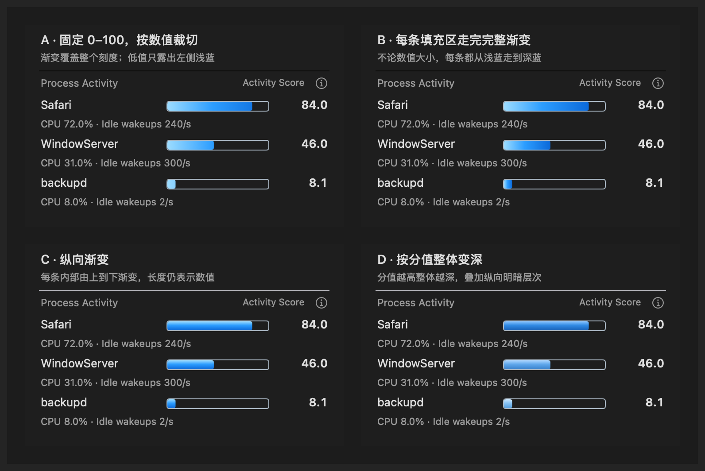
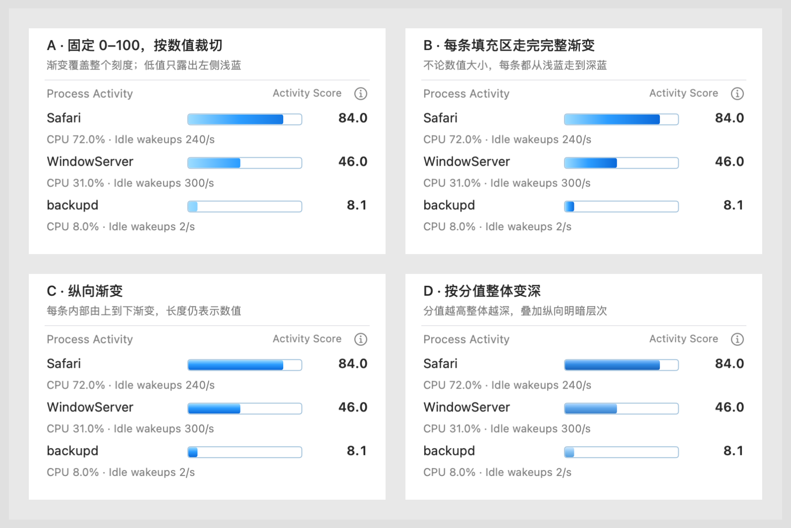

# Process Activity gradient comparison

These four visual alternatives use the same production AppKit view, geometry,
Activity Score wording and fixture readings: 84.0, 46.0 and 8.1. The outer
A–D labels belong to the review fixture, not the app's interface.

| Option | Gradient behavior |
| --- | --- |
| A | The complete horizontal pale-to-deep blue gradient spans the fixed 0–100 scale. The current score reveals only that prefix. At 8.1, only the first 8.1% of the gradient is visible. |
| B | Every filled bar stretches the complete horizontal gradient to its own visible length. Even the 8.1 bar reaches the deepest blue at its endpoint. |
| C | Every filled bar has the same vertical light-to-dark gradient. |
| D | The whole bar's blue palette becomes deeper with increasing score, retaining a vertical highlight. |

Option A implements the user's latest requested comparison. A, B and C use
the same three colors: #9CDCFF, #2C9DFF and #0B69D9 at 0%, 45% and 100%.
The fixed scale remains 0–100 for all four, including zero, tiny and overflow
values. High contrast retains solid system blue and the numeric values.

The comparison selectors exist only in DEBUG builds. At capture time the normal
production renderer remained B for review. The user subsequently selected A;
see [the selected-style review](../fixed-scale-gradient/README.md) for the adopted
renderer and compact-display option. These comparison captures themselves add
no preference, sampling behavior or installation.

## Native previews





The previews are captures of actual fixture windows containing the production
renderer in a disposable ARM GUI VM. They use deterministic process readings.
They demonstrate styling rather than measured electrical power or live process
activity. Each board shows the same four options and readings.

Individual dark previews: [A](variant-fixed-scale-horizontal-dark.png),
[B](variant-filled-width-horizontal-dark.png), [C](variant-vertical-dark.png),
[D](variant-activity-tint-dark.png).

## Verification

The final capture run passed 728 assertions across six native screenshots.
All 12 focused view tests passed, including fixed-scale masking at zero, tiny,
normal and overflow scores, appearance changes and switching between styles.
Release sources also passed a macOS 12-targeted typecheck without DEBUG.
The 35-second preference observation and all ten resource-cleanup checks passed;
the owned VM was deleted and the canonical installation was unchanged.

See [verification.json](verification.json), [capture-evidence.json](capture-evidence.json)
and [pixel-contrast-audit.json](pixel-contrast-audit.json) for recorded evidence.

## Reproduce

Run inside a disposable macOS GUI VM:

```sh
WATTSON_RUN_GUI_TESTS=1 bash scripts/verify_top_processes.sh --gradient-comparison OUTPUT_DIRECTORY
```

The entry point owns its temporary app, registration, preferences and processes.
The external test session owns the VM's creation and deletion.
